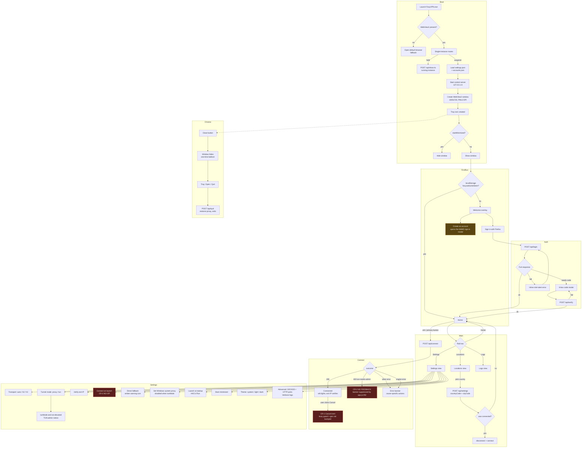

# FoxyVPN for Windows — Design, Layout, UX & UI-Architecture Audit

> **Naming note.** This audit was written while the app was still called
> FoxyVPN. It has since been renamed **Todnet**. The old name is kept
> throughout this document as the historical record of what was audited.

**Subject:** `foxy-windows/` — the Ember redesign, branch `redesign/ember` @ `2031f00`
**Scope:** every screen, component, style, asset and flow of the Windows client
**Method:** full source read of the Go backend, the embedded web front-end, the Win32 layer and the verification harness; static review of the 24-image screenshot matrix in `foxy-windows/docs/`; **live inspection** of the running application (headless control server on an isolated `APPDATA`, driven through a real browser engine) with a computed-contrast solver applied to every token pair
**Date:** 2026-10-19
**Status:** read-only. No project file was modified, created or deleted other than this report.

> **Provenance.** An earlier audit of the *pre-Ember* baseline (commit `3da336e`) lived at this path and was referenced by the short IDs `K-01`, `W-02`, `T-03`, `U-05`, `S-03`, `A-02`, `X-07` in `foxy-windows/REDESIGN_NOTES.md` and in source comments. This report **supersedes** it: it audits the shipped Ember tree. Where a baseline finding was fixed, this report says so explicitly; where it regressed, the original ID is cited in parentheses so the trail stays unbroken.

> **Verification legend.** `Live-verified` = reproduced against the running app in this session. `Source-verified` = proven by reading the implementation. `Measured` = computed numerically (contrast solver, layout metrics read from the live DOM).

> **Harness note (2026-10-22).** The development harness this report used —
> `tools/shoot_ember.js`, `tools/a11y_check.js`, the MCP client and the
> browser-driven suite — is no longer part of the working tree; it is
> preserved in git tag `e2e-harness-v1`. References to those scripts describe
> the verification of the time, not files in the current checkout.

---

## Table of Contents

1. [Executive Summary](#1-executive-summary)
2. [Tech & Architecture Snapshot](#2-tech--architecture-snapshot)
3. [Screen & Flow Inventory](#3-screen--flow-inventory)
4. [Detailed Audit Findings](#4-detailed-audit-findings)
   - [4.0 Critical findings (full write-ups)](#40-critical-findings-full-write-ups)
   - [4.1 Aesthetic, Visual Identity & Design System](#41-aesthetic-visual-identity--design-system-the-feel)
   - [4.2 Layout, Spatial Architecture & Windows-Native Fit](#42-layout-spatial-architecture--windows-native-fit)
   - [4.3 Core VPN Component & Experience Breakdown](#43-core-vpn-component--experience-breakdown)
   - [4.4 UI Components, Motion & Micro-Interactions](#44-ui-components-motion--micro-interactions)
   - [4.5 Usability, Cognitive Load & Accessibility](#45-usability-cognitive-load--accessibility)
   - [4.6 Code-Level Design Health](#46-code-level-design-health)
   - [4.7 Competitor Benchmark](#47-competitor-benchmark)
5. [Extracted Design Tokens](#5-extracted-design-tokens)
6. [Inconsistency Log](#6-inconsistency-log)
7. [Missing States & Edge Cases](#7-missing-states--edge-cases)
8. [Redesign Constraints & Risk Assessment](#8-redesign-constraints--risk-assessment)
9. [Prioritized Redesign Roadmap](#9-prioritized-redesign-roadmap)
10. [Open Questions](#10-open-questions)
11. [Appendix A — Verification Method](#appendix-a--verification-method)

---

## 1. Executive Summary

### Overall impression

The Ember redesign is a **credible, above-average piece of front-end craft for a side project**, and it is a decisive improvement on the pre-Ember baseline it replaced. The token layer is disciplined, the component vocabulary is coherent, the copy is unusually well-judged for a VPN client ("No subscription, no upsells, no telemetry"), and the accessibility contract is enforced structurally rather than by convention — every control is built from `web/js/components/ui.js`, which is exactly the right way to prevent the class of defect the earlier audit found.

But the audit found a **severe split between what the interface promises and what the engine does**. The Ember tree is a well-dressed shell over a backend that has drifted away from it. Four findings are *Critical*:

| # | Finding | Evidence |
|---|---|---|
| **CR-1** | **"Cancel" during Connect is completely inert.** The button says Cancel; clicking it issues no request and the tunnel comes up anyway. | **Live-verified** |
| **CR-2** | **TUN mode without administrator rights produces zero feedback.** The Connect button appears completely dead. | **Live-verified** |
| **CR-3** | **"Connect on launch" is a no-op.** The switch saves to `settings.json` and is read by nothing. | **Live-verified** (round-trip) + source |
| **CR-4** | **`body.motion-paused` freezes one-shot entrance animations.** The entire Home view can be left at `opacity: 0`. (full write-up: **I-1**) | **Live-verified** |

CR-1 and CR-2 are the same class of defect the project has fought twice already — a button that looks dead. Both are regressions against the pre-Ember tree, and both contradict explicit statements in `foxy-windows/README.md` (lines 141–152, 517). **The README currently documents behaviour the app does not have.** That divergence is itself a finding (**D-11**).

The visual layer, by contrast, is in good shape. Text contrast passes WCAG AA on **every** token pair in both themes — the highest-scoring area of the audit. The failures are all in *non-text* contrast (focus rings, input borders, light-theme accent borders) and in *functional* correctness.

### Top 5 UI/UX failures holding the app back

1. **CR-1 — Cancel does not cancel.** `app.js:304` `disconnect()` opens with `if (busy) return;`, and `busy` is held `true` for the entire `POST /api/connect` (the server handles the connect synchronously, `server.go:1118`). Independently, `engine.Disconnect()` (`engine.go:125`) never increments `e.gen`, so the in-flight `connectInner` still satisfies `e.gen == gen` at `engine.go:355` and installs the tunnel. Two independent bugs stacked on one button. *Live-verified: `disconnect` request count did not increase on the Cancel click; the stage transitioned `busy → ok` and the headline became "Connected" 5 s later.*
2. **CR-2 — TUN-without-admin is silent.** `app.js:292` (`if (!(err instanceof ApiError) || !err.code)`) suppresses the error banner for *any* response carrying a `code`, and `tun-needs-admin` (`server.go:1113`) is the only coded error the API produces. Because the 403 returns before the engine is touched, the engine state never becomes `error`, so `checkConnectionOutcome` (`app.js:232`) never fires either. Result: banner 0, toast 0, headline unchanged, live region empty. *Live-verified against the server's exact response body.*
3. **CR-3 — "Connect on launch" does nothing.** `store.Settings.AutoConnect` (`settings.go:26`) is written to `settings.json` and read by **no Go code anywhere** — verified by exhaustive grep across `internal/**` and `main.go`. The Settings switch ("Start the tunnel automatically when FoxyVPN opens") is a lie.
4. **L-1 — The default window has an unlabelled navigation.** The app opens at **1000×720** (`main.go:184`), and the compact-rail media query is `max-width: 1099px` (`views.css:176`, `tokens.css:160`). **The default window is therefore always the compact 76 px icon-only rail**: the wordmark, all four nav labels and the entire state text are `display: none`. *Live-verified: `navLabelDisplay = ["none","none","none","none"]`, `--rail-w` resolved to `76px`.*
5. **A-2 — The focus ring fails WCAG 2.2 SC 1.4.11 on the primary button.** `:focus-visible` uses `outline: 2px solid var(--accent-text)` (`base.css:43`) — **#FF9A66 on #FF7A3D = 1.24:1** (dark) and **#B23A05 on #FF7A3D = 2.31:1** (light), against a required 3:1. The ring is orange on an orange button. It is visible in `docs/welcome-dark.png` as a barely-different orange halo.

### Top 5 strengths — what works and must be preserved

1. **The token layer is genuinely excellent.** `web/css/tokens.css` is a complete, single-source design system: 4 surfaces, 3 text levels, 4 semantic colours × 3 variants, 3 elevation shadows, an 8-step type scale, an 11-step space scale, 5 radii, 5 motion durations and 3 easings — each with a light-theme override of the same names, so **no component knows which theme is active**. The file's own header says *"Every colour outside this file is a bug"*, and the audit confirmed that is **almost** true (14 stray hex values; see §6).
2. **Text contrast passes AA everywhere.** All 36 token-on-token text pairs in both themes clear 4.5:1 — the *worst* is `--text-3` on `--surface-3` at **4.70:1** (dark) and **4.81:1** (light). Three token values were deliberately re-picked to reach that bar and the reasoning is recorded in `tokens.css:128`, `:134`, `:138`.
3. **The accessibility contract is architectural, not aspirational.** `web/js/components/ui.js` is the only way to build a control. `switchControl` emits `role="switch"` + `aria-checked`; `segmented` emits `role="group"` + `aria-pressed`; `button()` guarantees an accessible name; `iconButton()` requires one. `tools/a11y_check.js` asserts 28 of these properties and **all 28 pass**. The baseline's `K-01` (seven non-focusable `div` toggles) and `K-02` are structurally impossible to reintroduce.
4. **The copy is the product's best asset.** "A quieter way to be private." "No subscription, no upsells, no telemetry." "Your account and settings stay on this device." `home.js:253` + `i18n.js:172–180` — this is a genuine differentiator against every competitor's alarmist dark-pattern marketing, and it is exactly what the README claims the product is.
5. **The diagnostic posture is a real differentiator.** `/api/diagnostics` builds a plain-text report containing the OS build, elevation state, adapter table and the last 400 log lines; the log throttles repeats to one line per 30 s with a folded count; TUN mode reads the TLS ClientHello to log hostnames. A competitor's "Contact support" flow is an email form. This is `README.md:457–484` realised in code.

---

## 2. Tech & Architecture Snapshot

| Layer | Technology | Notes |
|---|---|---|
| Shell | **Go 1.27.2**, `CGO_ENABLED=0`, single self-contained `FoxyVPN.exe` (13,745,664 bytes) | No installer, no runtime, no admin rights for proxy mode |
| UI host | **`github.com/jchv/go-webview2`** | Win32 + WebView2. Stock title bar; no custom chrome |
| Front-end | **Vanilla ES modules**, 13 files / 3,548 lines / 133,820 bytes | No framework, no bundler, no CDN, no npm dependency at runtime |
| Styling | **4 hand-written CSS layers**, 67,281 bytes | `tokens.css` → `base.css` → `components.css` → `views.css` |
| Icons | **One inline SVG sprite** in `web/index.html` (30 `<symbol>`s, hand-drawn 24×24 / 1.75 stroke) | No third-party icon licence; filled variants only for active nav |
| Flags | 33 bundled SVGs, `web/flags/` | 200,183 bytes; no CDN |
| Native layer | Raw `user32`/`dwmapi`/`shell32`/`advapi32` via `golang.org/x/sys/windows` | DPI, tray, window subclass, system proxy, autostart, UAC |
| Upstream | Mozilla Guardian proxy pass → Fastly MASQUE edge `*.m1.fastly-masque.net:2499` | HTTP/2 (default) or HTTP/3 (QUIC) CONNECT sessions |
| TUN | `golang.zx2c4.com/wintun` + `gvisor.dev/gvisor` netstack | `198.18.0.1/15`; DoH relay at `198.18.0.2` |
| Control plane | `net/http` on `127.0.0.1:0`, 18 endpoints | No authentication — any local process can drive the VPN |
| Tests | `go test ./internal/...` — all green | `internal/api`, `internal/store`, `internal/win` have **no** unit tests |

### High-level UI file map

```
foxy-windows/
├── main.go                        362 lines   window, tray, DPI, single-instance, shutdown
├── web/
│   ├── index.html                 224 lines   sprite, rail, view host, layer host
│   ├── css/
│   │   ├── tokens.css             162 lines   ← the entire design system
│   │   ├── base.css               225 lines   reset, type, focus, scrollbars, a11y modes
│   │   ├── components.css         741 lines   20 primitives
│   │   └── views.css              961 lines   rail, home, locations, settings, logs, overlays
│   └── js/
│       ├── app.js                 959 lines   router, rail, actions, overlays, keyboard
│       ├── state.js                87 lines   poll loop, diff signal, offline flag
│       ├── api.js                  57 lines   fetch client + endpoint map
│       ├── i18n.js                282 lines   245 flat keys, English only
│       ├── describeState.js       120 lines   the single source of state copy
│       ├── motion.js              139 lines   tween, flip, stagger, themeReveal, watchVisibility
│       ├── icons.js                15 lines   sprite helper
│       ├── components/ui.js       228 lines   h, button, iconButton, switch, segmented, ring, …
│       ├── components/overlay.js  278 lines   modal, popover, toast, banner
│       └── views/{home,locations,settings,logs}.js   396 / 340 / 421 / 296 lines
├── internal/
│   ├── api/server.go             1,390 lines   18 endpoints, auth, quota, diagnostics
│   ├── engine/                   8 files       controller, session, tunnel, socks5, httpproxy, logging
│   ├── tun/                      8 files       wintun, netstack, dns relay, icmp, sni
│   ├── vpnclient/                9 files       fxa, guardian, fastly, serverlist, accounts
│   ├── win/                      7 files       dpi, tray, window, sysproxy, autostart, elevate, sysinfo
│   └── store/settings.go         134 lines
└── tools/                        14 scripts    shoot_ember.js (24 shots), a11y_check.js (28 asserts)
```

**Dependency-free is not a constraint to escape from — it is the product.** A single 13.7 MB exe that works on a stock Windows 10 machine with no install is a genuine competitive position against Proton/Mullvad installers. Any redesign must preserve it.

---

## 3. Screen & Flow Inventory

### 3.1 Screen, modal and overlay inventory

| # | Surface | File / definition | Description |
|---|---|---|---|
| 1 | **Rail** | `web/index.html:176–210`, `views.css:8–196` | 232 px expanded / **76 px compact** (≤1099 px). Brand, 4 nav items, state chip, account card |
| 2 | **Home — stage** | `web/js/views/home.js:16–150`, `views.css:212–564` | Orb (232 px), headline, subline, primary action, location chip |
| 3 | **Home — Exit IP card** | `home.js:100–109` | Verified public IP + country + latency, copy-to-clipboard |
| 4 | **Home — Session card** | `home.js:112–126` | ↑/↓ byte counters, active-connection count, 34 px sparkline |
| 5 | **Home — Allowance card** | `home.js:129–137` | 56 px ring showing **remaining** quota + reset date |
| 6 | **Home — Connection details** | `home.js:140–145` | `<details>` disclosure: protocol, edge host, DNS source, mode |
| 7 | **Locations** | `web/js/views/locations.js`, `views.css:566–715` | Search, All/Favorites/Recent segmented filter, region groups, country grid, stars |
| 8 | **Settings** | `web/js/views/settings.js`, `views.css:717–795` | 5 groups: Connection, Windows integration, Appearance, Advanced (collapsible), Account, Version |
| 9 | **Logs** | `web/js/views/logs.js`, `views.css:797–851` | Level filter, text filter, follow/copy/diagnostics/clear, 2,000-line DOM cap |
| 10 | **Welcome overlay** | `app.js:831–866`, `views.css:853–891` | Full-screen first-run: mark, headline, 3 value props, 2 CTAs |
| 11 | **Login modal** | `app.js:630–718`, `views.css:893–933` | E-mail + password, eye toggle, inline `role="alert"` error |
| 12 | **Verification-code modal** | `app.js:720–815` | 6 separate 1-char inputs, paste handler, "I clicked the link" path |
| 13 | **Account popover** | `app.js:490–571`, `views.css:933–961` | Account list with per-account quota, Add account, Sign out |
| 14 | **Location picker popover** | `app.js:441–486` | Favorites + recents, "Locations →" |
| 15 | **Error banner** | `app.js:229–278`, `components.css:582–618` | In-flow, with cause-specific recovery actions and a raw "Details" disclosure |
| 16 | **Confirmation modals** | `app.js:573–626` | Remove account, Sign out — danger-toned |
| 17 | **Toast stack** | `components/overlay.js:203–231` | Bottom-centre, 4 s, hover-pause, progress hairline, optional action |
| 18 | **TUN-admin notice** | `views.css:761–773` | Settings-only inline notice with "Restart as administrator" |
| 19 | **System tray icon** | `internal/win/tray.go` | Always present; hover text = Connected/Disconnected |
| 20 | **System tray menu** | `tray.go:344–388` | Open FoxyVPN / Connect–Disconnect / Quit — **hard-coded English** |
| 21 | **Tray balloon** | `tray.go:276–292`, `main.go:230` | One-time "FoxyVPN is still running" on first close-to-tray |
| 22 | **Win32 MessageBox** | `internal/win/window.go:118–123` | Panic, data-folder failure, listener failure, already-running |
| 23 | **Tooltip** | `components.css:366–396` | CSS `[data-tip]` pseudo-element, 500 ms delay, top/bottom |

### 3.2 User flow diagram



### 3.3 Clicks-to-connect

| Scenario | Clicks | Path |
|---|---|---|
| First run, signed out | 3 | Sign in → type e-mail → type password → Sign in → (code) → Home → Connect |
| Warm start | 1 | Click the orb, or the `Disconnect`/`Connect` primary button |
| Change location while connected | 2 | Rail → Locations → country row (reconnect is automatic) |
| Change location while disconnected | 2 | Rail → Locations → country row → auto-returns to Home |

**Best case is 1 click. That is genuinely competitive** — Proton VPN and NordVPN require finding and pressing a "Quick connect" button that is not the visual centre of the window. The orb is a large, unambiguous, single target.

---

## 4. Detailed Audit Findings

> **Severity key.** `Critical` = the app lies to the user or a control is inert. `High` = a primary flow is degraded or a legal/accessibility bar is missed. `Medium` = a real quality defect with a workaround. `Low` = polish.

> **Finding IDs.** `CR-1`…`CR-4` are the four Critical findings and are written out in full in §4.0. The remaining findings are grouped by pillar: `A-` aesthetic (§4.1), `L-` layout (§4.2), `V-` VPN components (§4.3), `I-` interaction & motion (§4.4), `U-` usability & a11y (§4.5), `D-` code health (§4.6).

---

### 4.0 Critical findings (full write-ups)

#### CR-1 · The "Cancel" button during a connection attempt is completely inert · Severity: Critical

**What & where.** Three files, two independent bugs, stacked on one button.

*Bug 1 — the client swallows the click.* `web/js/app.js:304`:
```js
async function disconnect() {
  if (busy) return;      // <-- returns immediately
```
`busy` is set to `true` at `app.js:284` and is only cleared in the `finally` of the `await endpoints.connect({})` call (`app.js:296–298`). The server handles `POST /api/connect` **synchronously** — `internal/api/server.go:1118` calls `s.eng.Connect(...)`, which performs the whole Guardian fetch, the TLS handshake to the edge and the listener setup inline before returning. The HTTP response therefore does not arrive until the connection is fully established, so `busy` is held for the entire attempt (seconds to tens of seconds). Clicking "Cancel" during that window calls `disconnect()`, which returns at the first line. **No request is ever sent.**

*Bug 2 — the engine would not honour it anyway.* `internal/engine/engine.go:125` `Disconnect()` never increments the generation counter `e.gen`; only `Connect()` does (`engine.go:189`). The cancellation check inside `connectInner` is `if e.gen != gen { … cancel … }` (`engine.go:355`). A disconnect during an in-flight connect leaves `e.gen == gen`, so `connectInner` proceeds to install the controller, the SOCKS5 listener, the HTTP listener and (in TUN mode) the adapter, and sets the status to `connected`. The tunnel comes up *after* the user cancelled it.

**Impact.** The Home primary button's label is derived from `describeState()` — `ACTIONS.connecting = 'cancel'` (`describeState.js:18`) — so while connecting it literally reads **"Cancel"**. It does nothing. *Live-verified:* with `/api/connect` stubbed to hang for 5 s (mirroring the real handler) and `/api/state` reporting `connecting`, the button read "Cancel" and the stage was `busy`; clicking it produced **no additional `/api/disconnect` request** (the request counter did not increase), and 5 s later the stage had transitioned `busy → ok` with the headline "Connected".

This is a *regression against the pre-Ember tree* and a direct contradiction of `foxy-windows/README.md:144–152`, which documents the TUN dialog and states that the app "never appears to do nothing". The in-code comment at `app.js:325` — `// Cancel is a disconnect: the engine aborts the attempt.` — describes behaviour that does not exist.

**Suggested direction.** Three coordinated changes:
1. **Server:** add `POST /api/cancel`, and have it bump the engine generation so the in-flight `connectInner` aborts at its `e.gen != gen` check. Return the current status.
2. **Engine:** make `Disconnect()` (or a new `Cancel()`) increment `e.gen` so any in-flight connect is invalidated. Add a `StateCancelling` state so the UI can show "Cancelling…" rather than a dead button.
3. **Client:** release the `busy` guard when the *request* returns rather than when the handshake finishes, and route the connecting state's primary action to `/api/cancel` instead of `/api/disconnect`.

---

#### CR-2 · TUN mode without administrator rights produces no feedback whatsoever · Severity: Critical

**What & where.** The server refuses the connection before the engine is touched — `internal/api/server.go:1105–1116`:
```go
if tunMode && !win.IsElevated() {
	engine.LogWarn("connect refused: TUN mode needs administrator rights (%s)", win.SystemSummary())
	writeJSON(w, http.StatusForbidden, map[string]string{
		"error": "TUN mode needs administrator rights. …",
		"code":  "tun-needs-admin",
	})
	return
}
```
The client drops it — `web/js/app.js:287–295`:
```js
try {
	await endpoints.connect({});
} catch (err) {
	await store.refresh();
	if (!(err instanceof ApiError) || !err.code) {   // <-- a coded error is NEVER shown
		const info = describeError(err && err.message ? err.message : '');
		showBanner({ kind: 'error', title: info.title, text: info.text, details: err && err.message });
	}
}
```
`tun-needs-admin` is the **only** coded error the entire API produces (`server.go:1113` is the sole occurrence of `"code"` in a response body). The condition therefore suppresses *exactly* the one error that matters most.

The second safety net also misses. `checkConnectionOutcome` (`app.js:229–244`) raises the banner on a state transition into `error` — but the 403 returns before `s.eng.Connect()` is called, so the engine state never leaves `disconnected` and there is no transition to detect.

**Impact.** A user selects TUN mode, clicks Connect, and **nothing happens at all**: no banner, no toast, no change to the headline, no announcement in the live region, no change to the button label. The only trace is a line in `app.log`. *Live-verified* against the server's exact response body, injected into the running client:

```
bannerCount: 0      toastCount: 0
headline:    "Disconnected"   (unchanged)
liveRegion:  ""       (nothing announced)
primary:     "Connect"        (unchanged)
stageState:  "idle"           (unchanged)
```

The app also already *has* the right copy and the right actions for this case, and simply never reaches them: `describeError()` maps "administrator" to `code: 'tun'` (`describeState.js:71–73`) and `recoveryActions('tun')` (`app.js:256–266`) returns exactly the two buttons the README promises — "Restart as administrator" and "Switch to system proxy mode".

**Suggested direction.** Invert the suppression condition so a coded error is *more* visible, not less: show the banner for `err.code === 'tun-needs-admin'` explicitly, or drop the `!err.code` guard entirely and let `describeError()` classify every failure. Additionally, have the engine record the refusal (set the state to `error` with a typed reason) so `checkConnectionOutcome` fires on the transition and the state is consistent for the tray tooltip and the rail chip. The `dialog.tun.*` strings (`i18n.js:227–231`) are already written and unused — the modal the README documents can be restored in minutes.

---

#### CR-3 · "Connect on launch" is a switch that saves a value nothing reads · Severity: Critical

**What & where.** `internal/store/settings.go:26` declares the field, `:41` sets the default, `:101` merges it on load. That is **every occurrence in the Go tree** — verified by an exhaustive case-insensitive grep across `internal/**` and `main.go`:
```
internal/store/settings.go:26  AutoConnect     bool   `json:"autoConnect"`
internal/store/settings.go:41  AutoConnect:     false,
internal/store/settings.go:101 merged.AutoConnect = parsed.AutoConnect
```
No engine, API handler, startup path or window handler ever reads it. Meanwhile the Ember UI exposes it as a first-class switch — `web/js/views/settings.js:85–89`:
```js
const autoConnect = switchControl({
	checked: false,
	label: t('settings.autoConnect'),      // "Connect on launch"
	onChange: (v) => save({ autoConnect: v }, 'autoConnect'),
});
```
with the description *"Start the tunnel automatically when FoxyVPN opens."* (`i18n.js:104`).

**Impact.** The user turns the switch on, sees the green "Saved" chip, closes the app, reopens it — and nothing connects. The setting persists faithfully in `settings.json` and is read by nobody. *Live-verified* round-trip against the running server: `GET /api/settings` → `autoConnect: false`; `POST /api/settings` with `autoConnect: true` → `GET /api/settings` → `autoConnect: true`. The write path works; the read path does not exist.

This is the same class of defect as CR-1 and CR-2 in its user-facing shape: **a control that visibly succeeds and does nothing.**

**Suggested direction.** Either implement it — read `settings.AutoConnect` in `main.go` after the engine and the control server are up, and call `eng.Connect()` with the stored location — or remove the switch, the field and the i18n key. Implementing it is a ~30-line change but needs a decision on *when* it runs (after the window is shown? silently at launch?), and it interacts with `startMinimized`. If it is deferred, the switch must be hidden rather than shipped inert.

---

#### CR-4 · `body.motion-paused` freezes one-shot entrance animations — *written up as **I-1** in §4.4*

**What & where.** Fully written up as **I-1** in §4.4 (UI Components, Motion & Micro-Interactions). In brief: `web/js/motion.js:14–29` adds `body.motion-paused` whenever `document.hasFocus()` is false, and `web/css/base.css:209–213` applies `animation-play-state: paused !important` to **every** element — including one-shot entrance animations whose `from` keyframe is `opacity: 0`. *Live-verified:* the Home view was left at `viewOpacity: "0"` with `animationPlayState: "paused"` while the window was merely not the foreground window.

---

### 4.1 Aesthetic, Visual Identity & Design System ("The Feel")

#### A-1 · The brand mark is a generic fox, not a mark · Severity: Low

**What & where.** `web/index.html:39–41` defines `#i-fox` as a hand-drawn 32×32 path; it is reused at three sizes — 22 px in the rail (`.brand-mark svg`, `views.css:37`), 40 px on the welcome screen (`views.css:882`), and 42 px inside the 76 px mark tile (`views.css:870–881`). `tools/make_icon.py` rasterises the same vector into `web/icon.ico` (38,318 bytes) and `rsrc_windows_amd64.syso`.

**Impact.** The identity is *consistent* — genuinely a strength — but a fox silhouette in a rounded orange tile is one of the most common marks in the VPN category. The README's actual differentiator is the honesty of the copy and the no-subscription model, and neither is expressed visually. The mark says "generic VPN client"; the product says "independent client for Mozilla's VPN service, no upsells".

**Suggested direction.** Keep the fox, but let the *graphite-and-orange* palette carry the identity rather than the silhouette. Consider a secondary glyph — the ember glow itself, or a minimal "edge/portal" mark — for the window icon and tray, where the orange tile is 16×16 and the fox is illegible.

---

#### A-2 · The focus indicator fails 1.4.11 on the primary button · Severity: High

**What & where.** `base.css:42–47`:
```css
:focus-visible {
  outline: 2px solid var(--accent-text);
  outline-offset: 2px;
```
`--accent-text` is **#FF9A66** (dark) / **#B23A05** (light). The primary button fill is `--accent` **#FF7A3D** in both themes (`components.css:43`).

**Impact.** Measured contrast of the ring against the button it outlines:

| Theme | Ring | Fill | Ratio | Required |
|---|---|---|---|---|
| Dark | `#FF9A66` | `#FF7A3D` | **1.24:1** | 3:1 (SC 1.4.11) |
| Light | `#B23A05` | `#FF7A3D` | **2.31:1** | 3:1 |

This is the *only* focus indicator in the app and it lands on the most-used control. It is visible in `docs/welcome-dark.png`: the "Sign in with Firefox" button shows an orange ring that is almost the same hue as the button. Against other surfaces the ring is fine (#FF9A66 on `--surface-1` = 8.87:1), so the failure is specific to the accent-filled button — which is the button a keyboard user lands on first.

**Suggested direction.** Use a two-tone focus treatment that works on any fill: a 2 px `--text` inner ring plus a 1 px `--bg` outer ring (`outline` + `box-shadow`), or invert the ring to `--bg` on accent fills. The Fluent pattern (`outline: 2px solid var(--text)` with `outline-offset: 2px`) is the right precedent.

---

#### A-3 · Input field boundaries fail 1.4.11 in both themes · Severity: High

**What & where.** `components.css:313–333`:
```css
.input {
  border: 1px solid var(--border-strong);
  background: var(--surface-2);
```
`--border-strong` is `rgba(255,255,255,.12)` (dark) / `rgba(40,20,10,.14)` (light).

**Impact.** Measured against the field's own fill:

| Theme | Border | Field fill | Ratio | Required |
|---|---|---|---|---|
| Dark | `#393533` | `#1E1A17` | **1.42:1** | 3:1 |
| Light | `#D9D0CB` | `#F6EFEA` | **1.33:1** | 3:1 |

Every text input in the app is affected: login e-mail, login password, the 6 code boxes, the Locations search, the Logs filter, and the two port fields. `docs/login-dark.png` shows the password field's border is barely perceptible against the card. The *focused* field is fine (`border-color: var(--accent)` + a 3 px `--accent-soft` halo, 7.14:1 in dark) — the problem is only the resting state.

**Suggested direction.** Raise `--border-strong` to meet 3:1 against `--surface-2` in both themes (dark: `rgba(255,255,255,.28)` ≈ 2.2:1 → needs ≈ `.34`; light: `rgba(40,20,10,.30)` ≈ 2.6:1 → needs ≈ `.38`), or give inputs a distinct fill (`--surface-1` on `--surface-2`) so the *fill* difference carries the boundary.

---

#### A-4 · Light-theme accent fails 1.4.11 on every accent border · Severity: High

**What & where.** `--accent` (#FF7A3D) is used as a border/indicator in: `.rec-row` (`views.css:609`), `.loc-row.is-selected` (`views.css:675`), `.nav-pill` (`views.css:62`), `.btn.is-on` (`components.css:63`), `.ring-value` (`components.css:494`), `.orb-ring .arc` (`views.css:326`).

**Impact.** `#FF7A3D` on `--surface-1` (#FFFFFF) = **2.59:1** — fails the 3:1 non-text requirement. The rendered `--accent-line` (`rgba(255,122,61,.38)`) over white is `#FFD4C1` = **1.36:1**, worse. In the dark theme the same accent is 7.14:1 on `--surface-1` and passes comfortably. **This is a light-theme-only regression**: the selected-location row, the "Recommended" card, the active nav pill and the allowance ring all lose their affordance precisely in the theme that looks more "designed" in the screenshots.

**Suggested direction.** Introduce a dedicated `--accent-strong` token, darkened for light theme (e.g. `#B23A05`, already 4.79:1 on `--surface-3` and 6.00:1 on `--surface-1`), and use it for every *border* and *indicator* while keeping `--accent` for fills. Do not re-tint `--accent` itself — the orange fill is the brand and it is correct.

---

#### A-5 · Semantic "containers" are near-invisible against the page · Severity: Medium

**What & where.** `--surface-2` (#1E1A17 dark / #F6EFEA light) is used as the fill for the mode and transport pills (`.pill`, `views.css:250–262`), the protection chip (`.chip`, `components.css:223–248`) and the account card (`views.css:133–147`).

**Impact.** Measured against `--bg`:
- dark: `--surface-2` on `--bg` = **1.13:1**
- light: `--surface-2` on `--bg` = **1.07:1**

In `docs/home-connected-light.png` the "System proxy" and "h2" pills are almost impossible to see against the page. In `docs/home-disconnected-dark.png` the "Disconnected" chip is a barely-there grey lozenge. These are the two elements that tell the user *what state they are in* and *what mode they are in* — they have the weakest contrast of anything on screen.

**Suggested direction.** Either drop the fill entirely and let the label + dot carry the pill (a Fluent "InfoBadge" has no fill), or raise the fill contrast to ≥ 1.3:1 and give the chip a 1 px `--border-strong` outline so it has a defined edge.

---

#### A-6 · The orb's progress ring is a permanent 100 % circle · Severity: Medium

**What & where.** `home.js:263–269`:
```js
if (st.state === 'connected') offset = 0;
else if (st.state === 'connecting' || st.state === 'disconnecting') offset = CIRC * 0.28;
else if (st.state === 'error') offset = CIRC * 0.12;
```
The arc is `stroke-dasharray: CIRC` with `stroke-dashoffset` animating. In the connected state the offset is `0` — the arc draws a **complete circle**.

**Impact.** A full ring in a progress component is universally read as "a spinner frozen at 100 %". It carries no information in the connected state, and the *underlying track* (`--surface-3` on `--surface-1`, **1.18:1** measured) is invisible, so the connected orb appears as a bare orange circle with no context. Compare `docs/home-connected-dark.png`: a bright orange annulus around the core with nothing behind it. The design intent in `REDESIGN_NOTES.md:396` — "orange is light, not paint" — is achieved, but the ring that was supposed to be a progress indicator is now a decorative hoop that implies progress.

**Suggested direction.** When connected, fade the arc to a low-opacity "status ring" (or replace it with a full ring in `--accent-line` at reduced weight) and give the track real contrast. Reserve the spinning arc for the busy state only.

---

#### A-7 · The allowance ring fills with "remaining" but reads as "used" · Severity: Low

**What & where.** `home.js:330–348` fills the ring by remaining (`remaining = left / max`), which `REDESIGN_NOTES.md:167` records as a deliberate fix.

**Impact.** The choice is right (it agrees with the "30.8 GB left" label), but a ring that starts at 12 o'clock and runs clockwise to 61.6 % is *indistinguishable* from a ring showing 38.4 % used, unless the label is read. The arc is also `--accent` orange in both themes, so orange reads as "brand" rather than "warning" — and at 20 % remaining the ring turns `--warn` amber, which is a colour change with no textual counterpart.

**Suggested direction.** Keep "remaining", but make the arc's *end* explicit: a rounded cap plus a tick at the 0 % origin, or switch to a straight progress bar where the fill direction is unambiguous.

---

#### A-8 · The avatar palette is hard-coded in JavaScript · Severity: Low

**What & where.** `web/js/components/ui.js:129`:
```js
const AVATAR_COLORS = ['#A63D2A', '#8A4B1F', '#7A5A12', '#2F6B3A', '#1F6B63', '#2B4F8A', '#5B3F8A', '#8A2F63'];
```
**Impact.** All eight pass WCAG AA with white text (measured **6.28:1 – 8.32:1**), so the code comment's claim is accurate. But they live in JS, not in `tokens.css`, and the flag-chip fallback (`ui.js:153`) computes `hsl(h 32% 24%)` / `hsl(h 60% 82%)` at runtime from an FNV-1a hash of the country code (`ui.js:118–126`). Two problems: (a) a colour cannot be theme-adjusted — the same eight colours are used in light and dark, where they read as muddy; (b) the hash is not stable across a change to the seed string, so an account can change colour between builds.

**Suggested direction.** Move the avatar ramp into `tokens.css` as `--avatar-1 … --avatar-8`, add a light-theme variant, and use a stable, explicit hash (or the account's UID, which the API already returns) rather than the e-mail.

---

#### A-9 · Three off-scale type sizes are below 11 px · Severity: Medium

**What & where.** The token scale is 12/13/14/16/20/28/40 px (`tokens.css:61–74`). Off-scale sizes in use: **9.5 px** (`.flag-chip` fallback, `components.css:292`), **10.5 px** (`.log-lvl`, `components.css:300` and `views.css:834`; `.badge` is 11.5 px), **11 px** (`.loc-count` `views.css:598`; `.acct-meta` `views.css:958`), **11.5 px** (×9 — `.pill.mono`, `.account-sub`, `.metric small`, `.details-list dd`, `.loc-sub`, `.save-ok`, `.welcome-foot`, `.acct-mail`), **12.5 px** (×5), **15 px** (`.ip-value`).

**Impact.** 9.5 px and 10.5 px are below the practical floor for a Windows desktop app. The pre-Ember audit's `C-01`/`A-08` explicitly raised a 9.5–11.5 px floor; the redesign re-introduced it in the log-level badge and the flag fallback. Technical telemetry is the worst case: `.log-lvl` at 10.5 px is the level indicator for a 2,000-line log — the one place a user scans for `ERROR`.

**Suggested direction.** Promote the sub-12 px sizes to 12 px and 12.5 px, and add `--text-micro: 11px` to the token scale so the floor is explicit rather than accidental. Raise `.log-lvl` to 11 px with increased weight, and keep 10.5 px only for the letter-spaced flag fallback.

---

#### A-10 · The two themes are not equally resolved · Severity: Medium

**What & where.** The light theme overrides 20 tokens (`tokens.css:114–157`). The dark theme has 4 surfaces, 3 text levels, 4 semantic colours, 4 glow tints and 3 shadows; the light theme re-declares all of them, with hand-tuned values for `--ok` (#0E7043), `--warn` (#8A5A00), `--danger` (#B3261E) and `--accent-text` (#B23A05).

**Impact.** The light theme is *deliberately* and correctly re-tuned, not mechanically flipped — three dark values were changed to reach AA (`tokens.css:128`, `:134`, `:138`). But the *composite* treatments were not revisited: `.pill`, `.chip`, `.input`, `.seg-thumb`, `.modal` and `.popover` all rely on `--surface-2`/`--surface-3` separations that collapse in light (1.07:1, 1.25:1). Light mode is the better-looking theme in the screenshots precisely because it has fewer competing surfaces — which means the light theme is doing more work with less.

**Suggested direction.** Add an explicit `--surface-4` or strengthen `--surface-2` in light mode so that chips, pills, segmented tracks and inputs have a readable edge. Audit every `--surface-2`/`--surface-3` *pair* for ≥1.2:1 in light, not just the text-on-surface pairs.

---

### 4.2 Layout, Spatial Architecture & Windows-Native Fit

#### L-1 · The default window renders an unlabelled icon-only rail · Severity: High

**What & where.** The window is created at **1000×720** logical pixels (`main.go:184`, `win.LogicalSize(hwnd, 1000, 720)`). The rail compacts at `@media (max-width: 1099px)` (`tokens.css:160–162`, `views.css:176–196`).

**Impact.** 1000 < 1099, so **the default window always shows the 76 px compact rail**: `.brand-word { display: none }`, `.nav-item span { display: none }` (all four nav labels), `.account-meta { display: none }`, and `.rail-state span:not(.dot) { display: none }` — the state text. *Live-verified:* `navLabelDisplay = ["none","none","none","none"]`, `--rail-w` = `76px`, `railStateSpanDisplay = "none"`.

The app therefore opens as a 76 px strip of four unlabelled glyphs. The only affordances are `title` attributes (native tooltips: slow, not keyboard-reachable, not exposed to touch, and they do not appear in `docs/` captures). The `a11y_check.js` assertions pass because the icons have `aria-label`s — the *screen reader* experience is fine, but the *sighted* experience is four unexplained symbols. Worse, the four icons are Home / Location-pin / Gear / Document — the gear and the document are near-identical in weight at 20 px.

**Suggested direction.** Either (a) move the breakpoint to `max-width: 899px` so 1000 px shows the labelled rail, and/or (b) shrink the expanded rail to ~180 px so it fits a 1000 px window comfortably, and/or (c) default the window to 1160×760. Option (a) alone costs one number and immediately fixes the first-run impression. A labelled rail is also the only place the word "FoxyVPN" appears in the window.

---

#### L-2 · Roughly 27–47 % of the window is empty space · Severity: Medium

**What & where.** `.home-grid` (`views.css:223–234`) is `minmax(0,5fr) minmax(0,7fr)`; `.stage` has `min-height: 540px` but the compact media query resets it to `0` (`views.css:560–563`); the right stack is four cards.

**Impact.** *Live-verified at a 1036×886 viewport:* the stage is **472 px** tall and the stack **472 px** tall, in a client area of **886 px** — **414 px (47 %) of empty page below the content.** At the app's own 1000×720 default the figure is ≈192 px (27 %). `docs/home-disconnected-dark.png` and `docs/home-connected-dark.png` both show the content ending at y≈540 of 720 with a dead band beneath.

**Impact on the product.** A VPN client that is 47 % empty reads as unfinished, and the wasted area is exactly where a *status* element would earn its place. It also means the primary action and the telemetry are not vertically balanced — the orb floats in a 472 px column with 130 px of air above it.

**Suggested direction.** Make the grid fill the viewport: `.home-grid { min-height: 100% }` with the stage `flex: 1`, and let the right stack distribute. Then spend the reclaimed space on a **"Protection" summary strip** (a one-line statement of what is and is not protected) and on the missing per-location latency (§3.3).

---

#### L-3 · At the minimum window size the trust signal is below the fold · Severity: High

**What & where.** `@media (max-width: 959px) { .home-grid { grid-template-columns: minmax(0, 1fr); } }` (`views.css:232–234`). The minimum window is 760×560 (`dpi.go:36–39`, enforced through `WM_GETMINMAXINFO`).

**Impact.** At 760 px the two-column layout collapses to one column. *Live-verified* and visible in `docs/home-min-dark.png` (760×560): the stage card fills the entire viewport and the Exit IP / Session / Allowance cards are pushed below the fold — a sliver of the next card is visible at y≈550. The README (`README.md:42`) sells the Exit IP card as the thing that "confirms your real public IP and country after connecting, so you can see the tunnel actually working rather than trusting a spinner." **At the minimum size, that proof is invisible.**

**Suggested direction.** Do not collapse to a single column at 760 px. Reduce the orb to 160 px and the grid to `minmax(0,4fr) minmax(0,6fr)` so both columns survive down to 760 px; if a single column is unavoidable, reorder so the Exit IP card sits *above* the stage.

---

#### L-4 · Two different view-header spacing systems · Severity: Medium

**What & where.** Locations, Settings and Logs build a header with `h('div', {}, [h('h1', {class:'view-title'}), h('p', {class:'view-sub'})])` — **not** wrapped in `.view-head`, which carries `margin-bottom: var(--s-5)` (`views.css:200–206`). The Logs view does the same.

**Impact.** Locations (`views.css:568`) and Settings (`views.css:719`) add their own spacing (`.loc-head { margin-bottom: var(--s-4) }`, `.settings-col { gap: var(--s-3) }`), but Logs (`views.css:801`) puts its toolbar directly after the subline with only the toolbar's own `margin-bottom: 12px` — **no gap above it**. In `docs/logs-dark.png` the "Live activity from the tunnel." subtitle at y=71 and the "All | Info | Warn | Error" control at y=80 are **9 px apart**, against 20–24 px everywhere else. The header looks collided rather than grouped.

**Suggested direction.** Adopt `.view-head` on all four views and delete the per-view header spacing. One rule, one rhythm.

---

#### L-5 · The Locations toolbar leaves half the row empty · Severity: Low

**What & where.** `.loc-tools` (`views.css:569–579`) is a flex row containing the search (max 420 px) and the segmented filter. `docs/locations-dark.png` shows them ending at x≈725 of a 900 px content area.

**Impact.** 175 px of dead space to the right of the filter, while the "35 countries" count and the refresh button are stranded ~250 px away in the header row above. The count — a useful signal — is visually disconnected from the list it counts.

**Suggested direction.** Move the count badge next to the filter (or into the section title) and put the refresh button at the far right of the toolbar row, so the toolbar reads as one continuous band.

---

#### L-6 · The sticky Locations group header uses a hard-coded offset · Severity: Medium

**What & where.** `views.css:640–651`:
```css
.loc-group-title { position: sticky; top: 62px; z-index: 4; }
```
**Impact.** 62 px is the *assumed* combined height of the view padding (24) + toolbar (≈38). Any change to the toolbar height, the view padding, or the addition of a second toolbar row silently breaks the sticky offset — the section title then slides under the toolbar and is unreadable. There is no test and no comment flagging the coupling.

**Suggested direction.** Drive the offset from a custom property (`--loc-tools-h`) set once by the toolbar, or use `scroll-margin-top` on the group containers instead of a raw `top`.

---

#### L-7 · The popovers cover the primary action · Severity: Medium

**What & where.** `openPopover` (`components/overlay.js:138–199`) places the panel at `top = rect.top - pr.height - 8`, `left = rect.left`. Both the account popover (`app.js:562–570`, anchor = the 76 px rail button) and the location picker (`app.js:478–486`, anchor = the location chip) open **upward and to the right**, into the content area.

**Impact.** *Verified in `docs/account-menu-dark.png`*: the 300 px account popover (x = 12…312) sits directly on top of the **"Disconnect"** button and the location chip. *`docs/loc-picker-dark.png`*: the 268 px picker (y = 245…480) covers the **orb and the Disconnect button**. The popovers are anchored to the rail, but the rail is only 76 px wide, so a 300 px panel anchored `start` inevitably overlaps the stage.

**Suggested direction.** Anchor popovers to the *rail's* right edge (`left = rect.right`), open downward for the rail (there is 600 px of vertical space below), and reserve a "safe area" so a popover never covers the primary action. Also add a scrim behind a popover that overlaps the stage, or move the popover to a modal on small windows.

---

#### L-8 · The Locations picker does not distinguish favorites from recents · Severity: Medium

**What & where.** `app.js:441–486` builds `quick` from `favorites.slice(0,3)` then `recent.slice(0,3)`, and renders every entry as an identical `.menu-item`.

**Impact.** *Verified in `docs/loc-picker-dark.png`*: five country rows (Netherlands, Japan, United States, Germany, United Kingdom) with no indication of which are starred and which are merely recent. The user cannot predict what the list will contain, and the "Recommended / Fastest available" fallback in `app.js:458` is a text line, not a selectable row — it looks like a label, not a choice.

**Suggested direction.** Mark favorites with the star glyph, mark recents with a clock, and make "Fastest available" a real, selectable row that clears the country filter.

---

#### L-9 · The selected country is not marked in the picker · Severity: Low

**What & where.** `app.js:460–467` — the picker rows carry no `aria-pressed` and no check glyph, unlike the Locations grid (`locations.js:139–141`).

**Impact.** *`docs/loc-picker-dark.png`*: Netherlands is the active location (the chip under the orb says so) but nothing in the picker says so. The user has to close the popover and read the chip.

**Suggested direction.** Reuse the `.loc-check` draw-in animation (`views.css:689–694`) and set `aria-current="true"` on the active row.

---

#### L-10 · The account-remove button is invisible until hover · Severity: Medium

**What & where.** `views.css:960–961`:
```css
.acct-remove { opacity: 0; }
.acct-row:hover .acct-remove, .acct-remove:focus-visible { opacity: 1; }
```
**Impact.** A 28×28 icon-only destructive action with no visible affordance. In `docs/account-menu-dark.png` the trash button is absent from both rows. It is also the only way to remove an account, and it is invisible in a screenshot, in a screen recording, and to anyone who has not yet hovered. `focus-visible` does reveal it, so it is keyboard-reachable — the defect is discoverability, not access.

**Suggested direction.** Always show the trash at `--text-3` opacity (0.55) and raise it to full on hover. A destructive action should be visible-but-secondary, not invisible.

---

#### L-11 · The Settings column is narrower than the content grid and centred in a void · Severity: Low

**What & where.** `.settings-col { max-width: 760px; margin-inline: auto; }` (`views.css:719`) inside a `--content-max: 1120px` (`.view-inner`, `base.css:115–119`).

**Impact.** At 1040 px the Settings card spans x = 172…934, leaving ~96 px of empty page on the left and ~106 px on the right (measured in `docs/settings-dark.png`). The other three views use the full 1120 px. The Settings page therefore looks like a narrow document floating in a wide app, and the eye has to travel further to read the 1,200 px of prose in it.

**Suggested direction.** Either widen to 880–920 px (settings prose is the widest content in the app) or keep 760 px but move the whole column left-aligned to the content edge so the empty space is one-sided and reads as margin, not as a hole.

---

#### L-12 · The Windows-native layer is competent but conservative · Severity: Medium

**What & where.** `internal/win/dpi.go` implements per-monitor-v2 DPI (`SetProcessDpiAwarenessContext(-4)`, with a `SetProcessDPIAware` fallback), `WM_DPICHANGED`, `WM_GETMINMAXINFO` (760×560 client minimum), and `DwmSetWindowAttribute` dark caption (attribute 20, fallback 19) with explicit `DWMWA_CAPTION_COLOR` (0x000B0C0E) and `DWMWA_BORDER_COLOR` (0x00151114). `win/window.go` implements the single-instance mutex, the window subclass, and placement persistence to `%APPDATA%\FoxyVPN\window.json` with an off-screen check. `win/tray.go` is a complete Win32 `Shell_NotifyIconW` implementation with its own message loop on a dedicated OS thread.

**Impact.** What is *missing* against a modern Windows 11 utility:
- **No Mica / Acrylic.** `DwmSetWindowAttribute(38, 102)` (system backdrop type) is never called. The app has an opaque `--bg` fill and a dark caption; a Mica backdrop would make the caption feel integrated and is a 6-line change.
- **No custom title bar**, so no app-icon-in-caption, no caption hit-testing, and the app cannot express its own brand in the chrome.
- **No Snap Layouts** support (the app is resizable, so this is available for free on Win11 22H2+).
- **No native toast.** The only notification is a Win32 `NIF_INFO` balloon (`tray.go:276–292`), which Windows 10/11 renders with a de-emphasised "Windows Security"-style chrome and which is disabled by the "notification" setting for many users.
- **No Windows accent-colour integration.** `--accent` is a fixed brand orange (#FF7A3D) in both themes; Fluent would map the user's accent colour onto the focus ring, the switch and the primary button.
- **`WM_GETMINMAXINFO` clamps the track size but the app does not handle `WM_SIZE`/`WM_EXITSIZEMOVE` snap transitions**, so snapping to a quarter screen will reflow the web layout without a transition.

**Suggested direction.** Add Mica (with an opaque fallback for Win10 1809 and for `prefers-reduced-transparency`), and route the native focus/selection colours through the Windows accent for users who have not chosen the brand orange. Both are additive and low-risk. Note that the app is `asInvoker`; nothing here needs elevation.

---

#### L-13 · The tray never changes shape between states · Severity: Medium

**What & where.** `tray.go:217–248` installs a single 16 px icon (`pickIconImage(t.icon, 16)`) and never changes it. `RefreshTooltip` (`tray.go:258–272`) updates only `NIF_TIP`. `REDESIGN_NOTES.md:218–221` records this as a deliberate omission.

**Impact.** The notification area is the app's most-glanced-at surface. A user with 12 icons in the tray learns "the fox = FoxyVPN" and then has to hover to know whether the VPN is on — the single most important bit of state in the product. Every competitor (Proton, Mullvad, Nord) uses a filled vs outlined icon or a colour change.

**Suggested direction.** Ship a second 16 px ICO frame (a filled fox for connected, an outlined fox for disconnected) and swap `HIcon` via `NIM_MODIFY` when the state changes. The `pickIconImage`/`CreateIconFromResourceEx` plumbing already exists — this needs a second embedded image, not new Win32 code.

---

#### L-14 · Tray strings are hard-coded English in Go · Severity: Medium

**What & where.** `tray.go:250–255`:
```go
return "FoxyVPN — Connected"   // / "FoxyVPN — Disconnected"
```
`tray.go:353–359`:
```go
appendItem(menu, 1, "Open FoxyVPN")
appendItem(menu, 2, "Disconnect")  // replaced with "Connect"
appendItem(menu, 3, "Quit")
```
**Impact.** 245 strings live in `web/js/i18n.js`; the tray — a surface the user reaches precisely when the app is in the background — has none. The `common.trayHint` and `common.trayHintText` keys exist in the table and are **unused** (see §6). The tray menu also omits the account, the current location and the mode.

**Suggested direction.** Move the tray strings into a Go-side `i18n` package that mirrors `web/js/i18n.js` keys, or (cheaper) have the front-end push the localised label to the tray over the existing local control API. The tray currently has no "state" concept beyond two words; a third line such as "Netherlands · TUN" would be genuinely useful.

---

#### L-15 · The window has no app icon in the caption and no scaled icon set · Severity: Low

**What & where.** `win/window.go:158–182` calls `WM_SETICON` with the 32 px and 16 px frames from `web/icon.ico`; `rsrc_windows_amd64.syso` supplies the `RT_GROUP_ICON` for the shell. `main.go:188–190` sets it after the window is created.

**Impact.** `WM_SETICON` after creation works, but the `RSRC` group is what Explorer and the taskbar use; the syso was verified to contain 1 group with 2 icons (32 px + 16 px). **There is no 256 px frame**, so the icon in a large taskbar view or in Alt-Tab at 200 % scaling is upscaled and soft. `web/icon.ico` is 38,318 bytes — adding a 256 px PNG-compressed frame is cheap.

**Suggested direction.** Regenerate `web/icon.ico` with 16/32/48/64/256 px frames and refresh `rsrc_windows_amd64.syso`.

---

### 4.3 Core VPN Component & Experience Breakdown

#### V-1 · The Connect trigger is excellent — with one exception · Severity: Low (exception: Medium)

**What & where.** `home.js:70` (the `orb-btn` overlay), `home.js:86` (the primary button), `home.js:391–392` (both wired to `app.onPrimary()`). The orb is 232 px (196 px when compact), the core 150 px, with a 46 px power glyph that morphs into a shield on connect (`views.css:437–439`, `home.js:71–74`).

**Impact.** This is the strongest element in the app. One target, 232 px, always in the same place, with a shape change (power → shield) and a colour change (graphite → lit orange) that carries the state. The `settle` spring and the `shockwave` (`views.css:443–455`) reward the moment of connection. The eyebrow `REDESIGN_NOTES.md:151` — "Orange is light, not paint" — is exactly right, and the light-theme variant (`views.css:421–436`) correctly swaps the glow for a warm tint so it does not become a white disc.

The exception: the primary button and the orb are **two separate targets for the same action**. `updateAction` (`home.js:172–185`) keeps their labels in sync, but the button's text and the orb's glyph can disagree in edge cases (the button says "Cancel" while the orb still shows the power glyph in the busy state — `views.css:380–393` only changes the arc and the core colour, not the glyph). A user who clicks the orb during "connecting" gets a disconnect, but the orb's affordance does not say so.

**Suggested direction.** Keep both, but make the orb's busy state show a stop glyph rather than a spinning arc, and mirror the button's exact label in the orb's `aria-label` (which `updateAction` already does at `home.js:182` — the visual affordance is what is missing).

---

#### V-2 · The protection chip is the app's only state summary and it is nearly invisible · Severity: Medium

**What & where.** `home.js:20–23` builds `#protChip` as a `.chip`; `home.js:272` sets `className = 'chip tone-' + desc.tone`; `views.css:245` gives `tone-idle` only a colour change.

**Impact.** Measured: the chip's fill is `--surface-2` on `--bg` = **1.13:1** dark / **1.07:1** light. In `docs/home-disconnected-dark.png` the "Disconnected" chip is a faint grey lozenge. Worse, its meaning is duplicated three times — chip, orb, and the rail dot — with the chip being the least legible of the three. And the *coverage* distinction the app is most careful about (TUN = "All apps are protected" vs proxy = "Apps that use the Windows proxy are protected") lives in the `title` attribute (`home.js:274–276`) and in the stage subline, not in the chip.

**Suggested direction.** Make the chip the app's single, legible status statement: a 3 px accent/status bar on the inline-start edge, a real border, and the coverage phrase in the visible text rather than the tooltip. Then remove the rail dot (or keep it as a redundant, purely decorative indicator) to avoid three answers to one question.

---

#### V-3 · The Exit IP card is the right idea in the wrong place · Severity: High

**What & where.** `home.js:100–109`, `views.css:524–537`. The IP is rendered in `--font-mono` at 15 px (12.5 px when longer than 19 characters, `home.js:291`) with a copy button that appears on hover (`components.css:452–465`).

**Impact.** The card carries the single most trust-worthy number in the product, and the typography is right (monospace, tabular, copyable). Three problems:

1. **It is below the fold at the minimum window size** (L-3). The README sells this card; at 760×560 it does not exist on screen.
2. **In the disconnected and error states it shows "—" plus "Verified after connecting"** (`home.js:298`, `home.js:309`) — the *same* string whether the app has never connected or the last attempt just failed. A user who has just seen a failure reads "Verified after connecting" as an invitation, not as a diagnosis.
3. **The copy button is hover-only** (`opacity: 0` → `1` on hover/focus-within), so the affordance is invisible in a screenshot and to a touch user. It *is* keyboard-reachable via `:focus-within`, so this is discoverability, not access.

**Suggested direction.** Move the Exit IP into the stage card (under the headline), where it is the visible proof that the orb means something. Replace the placeholder strings with state-specific copy: "Not connected", "Verifying the exit address…", "Last verified exit: 185.152.65.42 (2 h ago)". Make the copy button always visible at `--text-3`.

---

#### V-4 · The session card shows counters but no throughput · Severity: Medium

**What & where.** `home.js:112–126` — an up-arrow, a down-arrow and two byte totals, plus "7 active" in the card header. The sparkline (`home.js:222–242`) plots **the sum of up+down per poll**, at a fixed 300×34 viewBox.

**Impact.** Three issues:
- **The sparkline has no scale, no unit and no axis.** It is a shape. It also plots up+down, so a download looks identical to an upload.
- **It is empty most of the time.** `drawSpark` requires `samples.length >= 3` (`home.js:226`), i.e. three 1-second polls after connecting. `docs/home-connected-dark.png` shows the Session card with a large empty region under the counters. `REDESIGN_NOTES.md:259–262` calls this deliberate ("a flat line looked like a divider"), which is a reasonable rule, but the *consequence* — a visibly hollow card — was not addressed.
- **The odometer is for cumulative bytes**, so "↑ 12.3 MB ↓ 224 MB" is a session total, not a rate. A user watching for a stall sees a number that barely moves.

**Suggested direction.** Show **rates** (bytes/s) as the headline with the session total as a secondary line, plot up and down as two separate series, and label the axis. While there is no data, collapse the sparkline's reserved height rather than leaving a hole.

---

#### V-5 · The Locations list shows only a flag and a country name · Severity: High

**What & where.** `locations.js:108–150`. The row renders `flagChip(countryCode)`, the country name, an optional `loc-sub`, optional signal bars, an optional check, and a star.

**Impact.** *Live-verified against the real server:* `/api/locations` returns 34 objects whose keys are exactly `countryName, countryCode, cityName, cityCode, host` — **`latencyMs` does not exist** (`anyLatency: false`). Consequences:
- `loc.latencyMs` at `locations.js:123` is **always undefined**, so the ping text (`t('loc.ping')` = "{ms} ms") and the `signalBars()` at `locations.js:127` are **unreachable code**. `signalBars` (`ui.js:158–163`) is therefore a dead component.
- `cityName === countryName` for **all 33** real locations (live-measured) — the API returns the country name as the city name — so the city is not available either.
- The `loc-sub` line therefore only ever shows the "n edges" variant, and only when `_edges > 1`; live-measured, **no country currently has more than one edge**, so `_edges` is always 1 and **`loc-sub` never renders at all**.

**Net effect: the Locations list is a list of flags and country names, with no latency, no city, no load and no edge count.** The i18n keys `loc.ping` and `loc.edges` are unreachable. This is the list every user visits to choose where their traffic comes from, and it carries one dimension of information.

**Suggested direction.** Add `latencyMs` to `engine.Location` and populate it (a single ICMP-free TCP handshake to `host:2499`, measured once and cached for 5 minutes, is enough for a real ping signal), and render the signal bars. Until then, **remove the dead code paths** so the codebase does not imply a capability the app lacks.

---

#### V-6 · There is no server-load, specialty-server or multi-hop concept · Severity: Low (honest)

**What & where.** The `Location` model has five fields. There is no `load`, no `tier`, no `streaming`/`p2p`/`obfuscated` flag, no `multiHop` count.

**Impact.** The brief's "specialty servers (P2P, Obfuscated, Streaming, Multi-hop)" has **no counterpart in this product**, and the README says so plainly ("Mozilla publishes only MASQUE edges"). Surfacing nothing is more honest than inventing a filter that never filters — but the Locations screen gives the *impression* of a richer list than it has, because the column headers and the grid look like a table with data that is not being shown.

**Suggested direction.** Do not add server categories. Add the one dimension that *is* available — latency (§V-5) — and let the grid earn its density.

---

#### V-7 · "Recommended" promises a measurement it never makes · Severity: Medium

**What & where.** `engine.go:804–811` maps the `REC` code to "Recommended" / "Fastest available"; `locations.js:74` and `i18n.js:74` repeat it. `engine.go:806`:
```go
if strings.EqualFold(code, recommendedCode) { return "Recommended", "Fastest available" }
```

**Impact.** The copy asserts "Fastest available edge, chosen automatically". The engine does not measure anything: `PickLocation` (`engine.go:833–861`) takes the **first** matching country alphabetically, and the `REC` entry simply points at Mozilla's own anycast catch-all. "Fastest" is a claim about a measurement that is never taken. The pre-Ember audit asked exactly this question ("What does 'Recommended' optimize for?") and it is still unanswered in the product.

**Suggested direction.** Either change the copy to what it is — "Mozilla's anycast edge" / "Automatically routed" — or make the claim true by measuring the latency of the candidate edges and picking the fastest. The second is better and the plumbing now exists if V-5 is implemented.

---

#### V-8 · Auto-select exists as a setting and as a chip, and does neither · Severity: Medium

**What & where.** `home.js:190` renders `t('home.location.auto')` = "Auto-select" when no location is resolved; `settings.js` has no auto-select control; `engine.go:229–243` — if no location is given, the engine fetches the server list and calls `PickLocation(countries, "", "")`, which returns the **first** location in the alphabetically-sorted list.

**Impact.** "Auto-select" implies the app picks the best node. It picks the first one alphabetically, filtered by the `countryCode` already stored in settings. `docs/home-disconnected-dark.png` shows the chip reading "Netherlands" with an auto-variant bolt icon in `docs/loc-picker-dark.png` — but the chip in the Home screenshot shows "Netherlands", i.e. the stored `countryCode`, not an auto state. The naming and the behaviour disagree.

**Suggested direction.** Make "auto" mean what it says: measure the candidate edges and pick the fastest, and label the chip "Auto (fastest)" so the promise is visible. Until then, rename it to reflect the real behaviour.

---

#### V-9 · There is no kill switch, no split tunnelling and no per-app control · Severity: Low (roadmap, not a defect)

**What & where.** The engine has `DirectFallback` (`engine.go:78–81`) — the deliberate *opposite* of a kill switch — and no WFP integration.

**Impact.** The pre-Ember audit classified a kill switch as P2 and flagged it as high-risk. That assessment still holds: WFP requires elevation and a bad rule set locks users off the network. The app's current posture — "the VPN server refused it, so I connected directly" — is explicitly labelled a leak, is **off by default**, and is marked with an amber warning triangle in Settings (`settings.js:140`, `warn: true`).

That warning treatment is the right pattern and should be the template for any future "this reduces your security" toggle. The brief's "Ad/Tracker/Malware Blockers" have **no counterpart in the product**; the client does not filter DNS or content and should not pretend to.

**Suggested direction.** Keep the roadmap item. If a kill switch is ever built, use the `setting-notice` + amber-triangle pattern, and give it a documented fail-safe.

---

#### V-10 · The "protection" claim is accurate but buried · Severity: Medium

**What & where.** `i18n.js:25–26`:
```
'state.hint.connected.tun': 'All apps are protected.',
'state.hint.connected.proxy': 'Apps that use the Windows proxy are protected.',
```
The proxy-mode string is shown in the stage subline (`home.js:257–260`).

**Impact.** The app is scrupulously honest that proxy mode does **not** protect everything — the pre-Ember audit called this out as a "worst combination" (default = proxy, copy = "Protected"), and Ember fixed the copy. But the honest string is 8 px below a 28 px headline in `--text-2` at 13 px, and the identical-sounding "All apps are protected" in TUN mode is the only place the difference is made.

**Suggested direction.** Make coverage a first-class, persistent element — a small shield chip in the stage card that reads "Protects: proxy-aware apps" or "Protects: all apps", always visible, with the difference colour-coded. A user who has chosen proxy mode (the default, no elevation needed) should be reminded of the limit *while connected*, not only in the settings description.

---

### 4.4 UI Components, Motion & Micro-Interactions

#### I-1 · `body.motion-paused` freezes one-shot entrance animations · Severity: Critical

**What & where.** `motion.js:14–29`:
```js
let visible = !document.hidden && document.hasFocus();
const emit = () => {
  const next = !document.hidden && document.hasFocus();
  ...
  document.body.classList.toggle('motion-paused', !visible);
```
`base.css:209–213`:
```css
body.motion-paused *, body.motion-paused *::before, body.motion-paused *::after {
  animation-play-state: paused !important;
}
```

**Impact.** `document.hasFocus()` is `false` for any window that is **visible but not the foreground window** — not just for hidden ones. The rule therefore freezes *every* animation, including **one-shot entrance animations**. The Home view's entrance is `view-in-forward` (`base.css:122`, `125–128`), whose `from` keyframe is `opacity: 0`.

*Live-verified in the running app:*
```
bodyClasses:             "motion-paused"
hasFocus:                false
hidden:                  false
viewClasses:             "view is-entering-forward"
viewAnimationName:       "view-in-forward"
viewAnimationPlayState:  "paused"
viewOpacity:             "0"
```

**The entire main content area was invisible in the live render.** A user who clicks a nav item and immediately switches to another application leaves FoxyVPN showing a blank content pane until they return and focus the window. The same applies to the Logs view, where **every** log line carries `animation: log-in 140ms` (`views.css:824`) — an unfocused window accumulates invisible log lines, which then all pop in at once on refocus.

**Suggested direction.** Scope the pause to *continuous* animations only, not to entrance transitions. The cleanest fix is to replace the blanket `animation-play-state: paused` with an explicit opt-in class on the elements that loop (`.orb-core`, `.ambient::before/after`, `.arc`, `.arc-dash`, `.dot-pulse`, `.drift-*`, `.shimmer`, `.spin`), or to wrap the looping animations in a `@media (animation-play-state: paused)`-friendly `@keyframes` with `animation-iteration-count: infinite` and toggle only those. A second, independent fix: make the view-entrance animation `from { opacity: .4 }` rather than `0`, so even a frozen frame is legible.

---

#### I-2 · The log level filter omits DEBUG, but DEBUG lines are displayed · Severity: Medium

**What & where.** `logs.js:28`:
```js
const LEVELS = [['ALL', t('logs.all')], ['INFO', 'Info'], ['WARN', 'Warn'], ['ERROR', 'Error']];
```
The engine emits `DEBUG` lines whenever verbose logging is on (`engine/logging.go`; `README.md:513`).

**Impact.** *Verified in `docs/logs-dark.png`*: the list is full of `DEBUG` badges while the filter offers only All/Info/Warn/Error. A user cannot isolate debug lines, and the filter implies DEBUG does not exist. The filter's `aria-label` is the generic `t('logs.title')` = "Logs" rather than something like "Log level".

**Suggested direction.** Add a `DEBUG` option, and label the group "Log level". Consider a `Trace` level if the engine ever gains one.

---

#### I-3 · The primary button is 100 px wide next to 390 px inputs · Severity: Medium

**What & where.** `app.js:660–670`:
```js
const form = h('form', { class: 'login-form', novalidate: true }, [...]);
const submit = button({ label: t('login.submit'), variant: 'primary', size: 'lg', type: 'submit', cls: 'is-fixed' });
form.append(h('div', { class: 'login-row' }, [submit]));
```
`.login-row` is `display: flex; justify-content: space-between` (`views.css:899`); with one child it lands at flex-start.

**Impact.** *Verified in `docs/login-dark.png`*: the "Sign in" button is ~100 px wide at the left edge of a 390 px form, with ~290 px of empty space beside it. This is the modal's only call to action and it looks like a stray control. The `.modal-actions` container is `flex-direction: column` (`components.css:672`) and would have given a full-width button had the submit lived there.

**Suggested direction.** Make the submit button `width: 100%` (or move it into `.modal-actions`). Add the two missing secondary links under it — "Forgot password?" and "Create an account" — both of which already exist as unused i18n keys.

---

#### I-4 · The "Create an account" CTA opens the sign-in dialog · Severity: High

**What & where.** `app.js:842–855`:
```js
button({ label: t('welcome.cta'),   variant: 'primary', size: 'lg', onClick: () => { dismissWelcome(); openLogin(); } }),
button({ label: t('welcome.create'), variant: 'ghost',   size: 'lg', onClick: () => { dismissWelcome(); openLogin(); } }),
```
**Both buttons call the same function.** The same is true in the login modal's dead `login.create` key.

**Impact.** A user with no Firefox account clicks "Create an account" — the button explicitly labelled as the one for people who do not have an account — and gets a *sign-in* form asking for a password they have never set. This is the worst kind of small UI lie: it is not malicious, but it is exactly the kind of thing the pre-Ember audit called "a dead end" and what the product's own copy ("no upsells") sets up a promise against.

**Suggested direction.** Make "Create an account" open `https://accounts.firefox.com/signup` in the system browser (the app already has `win.OpenURL`, `window.go:126`). The `welcome.learn` key ("Learn more") is defined and unused and should point at the Mozilla VPN page.

---

#### I-5 · The login modal has no password-recovery path · Severity: High

**What & where.** `i18n.js:192` defines `login.forgot` = "Forgot password?" — it is **never rendered** (see §6). The login modal contains only the e-mail field, the password field and the submit button (`app.js:660–670`).

**Impact.** A user who forgot their Firefox password — the single most common reason people cannot sign in to a Mozilla service, since Firefox *does* have a "forgot password" flow — has no path forward inside the app. The `login.legal` line ("No subscription required…") is also unused, so the reassurance the copy was written for is not shown.

**Suggested direction.** Add a "Forgot password?" link that opens `https://accounts.firefox.com/reset` externally, and show the `login.legal` line as a footnote under the button.

---

#### I-6 · The welcome overlay has no focus trap, no dismiss control and a second `h1` · Severity: High

**What & where.** `app.js:831–866`:
```js
const overlay = h('div', { class: 'welcome', id: 'welcome', role: 'dialog', 'aria-modal': 'true', 'aria-labelledby': 'welcomeTitle' });
...
overlay.addEventListener('keydown', (e) => { if (e.key === 'Escape') dismissWelcome(); });
```
**Impact.**
- **No focus trap.** `openModal` installs one (`overlay.js:97`); `showWelcome` does not. Tab walks straight out of the overlay into the app behind it, while `aria-modal="true"` tells assistive technology the rest of the page is inert. The two claims contradict each other.
- **No visible dismiss affordance.** The only way out is the Escape key, which is not discoverable and is impossible on a touch device. There is no "Skip", no close button, no "Maybe later".
- **A second `h1`.** *Live-verified:* `h1s = ["Disconnected", "A quieter way to be private."]`. `tools/a11y_check.js:156` asserts "home has one h1" — but the harness sets `foxy.welcomeSeen = '1'` before the assertion, so the check never exercises the state a first-time user actually sees.
- **The overlay is `z-index: 55` (`views.css:858`) while the modal scrim is `z-index: 60` (`components.css:625`)** — if a modal is ever opened on top of the welcome, the welcome renders *underneath* the scrim.

**Suggested direction.** Reuse `openModal` for the welcome (it already provides the trap, the Escape handling, the focus restore and the scrim), add a visible "Skip for now" ghost button, and change the welcome's heading to an `h2` so the app's single `h1` remains the screen title.

---

#### I-7 · The modal action row is `column` but is used as `row` · Severity: Low

**What & where.** `components.css:672–673`:
```css
.modal-actions { display: flex; flex-direction: column; gap: 8px; margin-top: var(--s-5); }
.modal-actions.row { flex-direction: row; justify-content: flex-end; }
```
`overlay.js:62–75` always builds `.modal-actions` **without** the `row` modifier.

**Impact.** Every modal's buttons are stacked vertically at the left edge — which is right for a 2-button mobile-style dialog, but it means a "Cancel / Remove" pair renders as two full-width stacked buttons in a 440 px desktop dialog, and the `row` variant is dead code. Compare `docs/account-menu-dark.png` and the confirm dialogs: a 440 px-wide modal with two 120 px buttons stacked on the left is an odd shape.

**Suggested direction.** Either apply the `row` modifier for confirmations (Cancel right, destructive action left or right per convention) or make the column layout intentional — full-width stacked buttons, which is a legitimate desktop pattern, but then the buttons must be `width: 100%` and the primary must be last.

---

#### I-8 · The error copy is duplicated verbatim in two places · Severity: Medium

**What & where.** `home.js:252–260`:
```js
const failure = st.state === 'error' ? describeError(st.error) : null;
setText(headline, failure ? t('error.title') : desc.label);
if (failure) { setText(subline, failure.text); }
```
and `app.js:232–240`:
```js
showBanner({ kind: 'error', title: info.title, text: info.text, details: state.status.error || '', actions: recoveryActions(info.code) });
```

**Impact.** *Verified in `docs/home-error-dark.png`*: the banner reads "The connection timed out / The VPN server did not answer in time. Another location may work better." and the stage subline reads **the same sentence**, while the headline reads "Could not connect". The user reads the same failure explanation twice, side by side, in two different type sizes.

**Suggested direction.** In the error state, the stage should carry the *headline and a short next step* ("Could not connect · Try another location"), and the banner should carry the detail and the actions. Or drop the banner when the stage is already showing the error. Pick one owner per piece of information.

---

#### I-9 · "Verified after connecting" is shown for a failed connection · Severity: Medium

**What & where.** `home.js:309`:
```js
exitMeta.append(h('span', { text: verifying ? t('home.exit.verifying') : t('home.exit.empty') }));
```
`t('home.exit.empty')` = "Verified after connecting". The allowance card uses `t('home.allow.unknown')` = "Available after connecting" (`home.js:346`).

**Impact.** In `docs/home-error-dark.png` — the *error* screen — the Exit IP card shows "—" / "Verified after connecting" and the Allowance card shows "—" / "Available after connecting". Both strings describe a *not yet connected* state and are wrong in a *failed* state. The user is told the card will fill in later, when in fact the attempt is over.

**Suggested direction.** Introduce a third state: "Not available — the last attempt failed", and use "Verified after connecting" only when the state is genuinely `disconnected` and the user has connected before.

---

#### I-10 · The Logs view header crowds its toolbar · Severity: Medium

**What & where.** Covered in detail as L-4. *Verified in `docs/logs-dark.png`*: the subtitle baseline is at y≈71 and the segmented control's top edge is at y≈80 — a **9 px** gap, against 20–24 px on the other three views.

**Impact.** The toolbar looks like it belongs to the subline rather than being a separate band. It also makes the Logs view the only one whose controls are not aligned to the same 24 px grid as the rest of the app.

**Suggested direction.** Use `.view-head` (L-4) and give `.logs-toolbar` a `margin-top` that puts it on the 4 px space scale.

---

#### I-11 · The log panel clips the first row mid-glyph · Severity: Low

**What & where.** `views.css:803–813`: `.logs-panel { padding: 6px 0; overflow-y: auto; }`; `.log-line { padding: 2px 14px; }`.

**Impact.** *`docs/logs-dark.png`* shows the top line ("socks: listening on 127.0.0.1:1080") cut in half by the panel's top edge. A scrolled-to-bottom log view should not present a half-rendered line as its first impression; the panel should either fade the top edge (a mask) or the line should be fully clipped out of view.

**Suggested direction.** Add a `mask-image: linear-gradient(...)` to the top of the panel, or a 1 px inset border with a `scroll-padding-top`.

---

#### I-12 · The `tunnel` state and the `popover` state have no escape affordance beyond Escape · Severity: Low

**What & where.** `overlay.js:138–199` — the popover closes on outside `mousedown` and on Escape. There is no close button, and no `aria-haspopup`/`aria-expanded` pairing beyond the account button's `aria-expanded` (`app.js:570`).

**Impact.** The popovers are dismissible by clicking away, which is discoverable enough. The missing piece is the `role="dialog"` + `aria-label` combination: the popover has `role="dialog"` (`overlay.js:142`) but no `aria-modal`, and its focus is moved into it (`overlay.js:193–196`) without being trapped. For the account menu — a list of radio-like choices — `role="menu"`/`menuitemradio` would be more accurate than `role="dialog"`.

**Suggested direction.** Use `role="menu"` + `menuitemradio` for the account popover (it already implements Arrow-key navigation at `overlay.js:179–186`), and add a visible close button to the location picker.

---

#### I-13 · The nav micro-animations are decorative motion on hover · Severity: Low

**What & where.** `views.css:97–102`:
```css
.nav-item:hover .nav-icon-gear { animation: gear-nudge 500ms var(--ease-out); }
.nav-item:hover .nav-icon-pin  { animation: pin-bob 400ms var(--ease-out); }
.nav-item:hover .nav-icon-doc  { animation: doc-nudge 400ms var(--ease-out); }
```
**Impact.** Three different, non-essential animations fire on every hover of every nav item. Combined with the `ear-twitch` on the brand mark (`views.css:38–43`) and the `dot-pulse` on the busy chip, the app has a lot of small motion that carries no information. The pre-Ember audit's `T-*` findings were about the *type scale*, but the same principle applies: motion should be reserved for state changes, not decoration.

**Suggested direction.** Remove the hover micro-animations. Keep the brand twitch (it is the one moment of personality) and the state-driven motion (orb, arc, settle, shockwave).

---

#### I-14 · The `has-modal` class is set but never used · Severity: Low

**What & where.** `overlay.js:80`: `document.documentElement.classList.add('has-modal')`; removed at `overlay.js:87`. Grepping `web/css` for `has-modal` returns **no rules** — the class is written and never styled.

**Impact.** Dead code that suggests a scroll-lock or inert-outside-the-modal behaviour was planned. It also means **the background is not inert and the page behind a modal can still scroll** via the wheel over the scrim (the scrim is `position: fixed` and captures events, so this is mostly moot — but keyboard focus can still reach the background, which I-6 already covers for the welcome).

**Suggested direction.** Either implement it (lock `body` overflow and set `inert` on `.app` while a modal is open) or delete it.

---

#### I-15 · `icon()` escapes only the attribute, and the raw-HTML path is used with interpolated values · Severity: Low

**What & where.** `icons.js:4–7` builds an SVG string; `escapeAttr` (`icons.js:13–15`) escapes `& < > " '`. `ui.js:14` supports `html:` on any attribute, and `ui.js:153` interpolates a computed hue into an inline `style`.

**Impact.** The `html:` path is used with `icon(...)` output only, which is safe today. But `h()` accepts arbitrary HTML from any caller, and there is no CSP header on the control server (`server.go:400–406` sets only `Cache-Control` and `X-Content-Type-Options`). A single future caller of `html:` with interpolated data would be an injection. The local API is also unauthenticated, so any local process can already drive the VPN.

**Suggested direction.** Add `Content-Security-Policy: default-src 'self'; img-src 'self' data:; style-src 'self' 'unsafe-inline'` to `noCache()` — cheap, and it hardens the unauthenticated local server. Remove the `html:` escape hatch from `h()` once the call sites are migrated to DOM APIs.

---

### 4.5 Usability, Cognitive Load & Accessibility

#### U-1 · Three indicators answer one question · Severity: Medium

**What & where.** The state is shown by (a) the protection chip at the top-left of Home (`home.js:20–23`), (b) the orb + headline + subline in the stage, and (c) the rail state chip (`app.js:199–202`, `index.html:199–201`).

**Impact.** All three are correct, but they are not equal citizens. The rail chip is the least legible (a 9 px dot at 76 px rail width), the protection chip is the second least (1.13:1 fill), and the orb is the loudest. The user's eye goes to the orb — which is correct — but the other two are visual noise that competes for the same question. Meanwhile the chip is the only element that carries the *coverage* distinction (via its `title`).

**Suggested direction.** Keep the orb and one persistent chip. Make the rail chip a pure, high-contrast status dot (or remove it and let the chip carry the state). One question, one answer, one place.

---

#### U-2 · The onboarding is good but the second-run experience is not · Severity: Medium

**What & where.** The welcome overlay (`app.js:831–866`) states the three facts that matter (50 GB included, data stays on the device, works on Win10/11) and offers a single primary CTA.

**Impact.** The welcome is shown **once** — `localStorage['foxy.welcomeSeen']` is set on dismissal (`app.js:873`) and it never returns. But the *second* run has no guidance at all: the user lands on Home, signed out, with a "Sign in" button and three empty cards ("Verified after connecting", "0 B", "Available after connecting"). Nothing explains what the app will do, what TUN mode is, or that proxy mode covers only proxy-aware apps.

**Suggested direction.** Keep the welcome for first run, but add a persistent one-line orientation to the signed-out Home: "Sign in to browse 34 countries. Proxy mode covers browsers and proxy-aware apps; TUN covers everything." A signed-out Home should explain the product, not show empty telemetry cards.

---

#### U-3 · The signed-out Home shows four empty telemetry cards · Severity: Medium

**What & where.** `home.js:147` builds the four-card stack unconditionally.

**Impact.** *Verified in `docs/home-disconnected-dark.png`*: the Exit IP, Session and Allowance cards are all present and all empty, while the headline says "Sign in with your Firefox account to connect." Three dead cards compete with the one thing the user should do. This is the pre-Ember audit's "cognitive load" concern in a new form.

**Suggested direction.** When signed out, replace the right stack with a single "What FoxyVPN does" card: the 50 GB allowance, the two coverage modes, the no-subscription stance. Show the telemetry cards only once there is something to show.

---

#### U-4 · The "Other" region group is a real defect for three countries · Severity: Medium

**What & where.** `locations.js:11–19`:
```js
const REGION = { AR:…, AT:…, AU:…, BE:…, BG:…, BR:…, CA:…, CL:…, CO:…, DE:…, DK:…,
  ES:…, FI:…, FR:…, GB:…, GH:…, IE:…, IT:…, JP:…, KR:…, MX:…, MY:…, NL:…, NO:…, NZ:…,
  PE:…, PH:…, PT:…, SE:…, SG:…, TH:…, US:…, ZA:… };
const REGION_ORDER = ['Europe', 'North America', 'Asia', 'South America', 'Oceania', 'Africa', 'Other'];
```

**Impact.** The map covers 32 country codes. The live server returns 33 real countries, and **CH (Switzerland), PL (Poland) and IN (India) are absent** — they fall into the catch-all "Other" bucket, which is sorted last, after Africa. A Swiss user looking for Switzerland finds it under "Other", at the very bottom, after Zimbabwe.

**Suggested direction.** Complete the map. Better still, derive the region from `Intl.DisplayNames`/CLDR rather than a hand-maintained table — the app already uses `Intl.DisplayNames` for country names (`describeState.js:113–118`), so the same data source can supply regions.

---

#### U-5 · Country names are server-supplied English and are not localizable · Severity: Medium

**What & where.** `engine.go:806` returns Mozilla's own `country.Name`; `locations.js:122` renders `loc.countryName` directly. `countryName(code)` (`describeState.js:113`) uses `Intl.DisplayNames` but only as a *fallback* when `countryName` is empty.

**Impact.** The i18n table has 245 keys, all English, and the string table is ready for a locale — but the largest visible set of strings (33 country names) comes from the Mozilla API in English and would stay English in every locale. The `flagChip` also falls back to a two-letter code tile for codes outside `FLAG_CODES` (`ui.js:116`) — **Switzerland (CH), Poland (PL) and India (IN) have no bundled flag**, so they render as a coloured letter tile with a runtime-computed HSL background, while 33 other countries get a crisp flag.

**Suggested direction.** Prefer `Intl.DisplayNames` over the server's English name, and add the three missing flags (or generate them from a scalable source). Also note `web/flags/es.svg` (80,958 B) and `mx.svg` (84,753 B) are 84 % of the 200 KB flag payload for two flags — optimise or replace them.

---

#### U-6 · The verb list is inconsistent · Severity: Medium

**What & where.** `i18n.js:209–225`:
```
'account.add': 'Add account'   'account.signOut': 'Sign out'   'account.removed': 'Removed {email}'
'account.removeConfirm': 'Remove {email} from this device?'     'account.signOutConfirm': 'Sign out of {email}?'
```

**Impact.** The interface mixes third-person and second-person: "**Add** account" (imperative, consistent with "Sign in", "Sign out") against "**Removed** {email}" (past tense, a toast) and "**Remove** {email} from this device?" (imperative, a question). The two are actually reconcilable — a toast reports a past event, a question asks — but "Sign out of {email}?" vs "Sign out" as a menu item reads as two different actions. `app.js:600–626` uses the `account.signOutConfirm` wording.

**Suggested direction.** Standardise: menu items are imperatives, confirmations are questions, toasts are past-tense reports. The current set mostly obeys this; the one genuine outlier is "Removed {email}" sitting next to "Now using {email}" and "Signed out".

---

#### U-7 · The technical vocabulary is mostly well-handled, with three exceptions · Severity: Low

**What & where.** `i18n.js:100` ("Auto uses TCP (HTTP/2) and falls back to QUIC when the edge refuses it"), `i18n.js:108` ("System proxy covers apps that use Windows proxy settings. TUN captures every app, needs administrator rights, and carries TCP only."), `i18n.js:62` ("Mozilla DoH via tunnel"), `i18n.js:63` ("Resolved by the edge").

**Impact.** The copy explains the jargon rather than assuming it, and the "Connection details" disclosure (`home.js:140–145`) puts the raw protocol and edge hostname one click away rather than in the main UI. That is the right balance. Three terms are unexplained: **"Direct fallback"** (the description explains what it does but not that it is a *deliberate leak* until you read the second sentence), **"Transport"** (fine), and **"Verifying your exit IP…"** (what is being verified, and against what?). The `settings.directFallbackDesc` does say "That traffic leaves your ISP connection unprotected" — good.

**Suggested direction.** Keep the current pattern. One addition: label the "Connection details" disclosure "Connection details (advanced)" so the user knows it is optional.

---

#### U-8 · Focus order reaches the primary action, but the rail comes first · Severity: Low

**What & where.** `index.html:182–197` puts the rail's four nav buttons before the main content; the account card and the state chip are at the bottom of the rail (`index.html:199–208`).

**Impact.** `tools/a11y_check.js:192–205` verifies that Tab reaches an interactive element and never escapes the window — both pass. But the order is: nav Home → Locations → Settings → Logs → **state chip** → **account card** → then the main content. A screen-reader user tabbing from the top gets six rail stops before reaching the page's own heading. The state chip and the account card are in the *middle* of the tab order relative to the visual order (they are at the bottom of the rail visually, so this is correct visually — but they are page-wide controls, not rail navigation, and they should come after the view's content or be reached by a landmark).

**Suggested direction.** Wrap the rail's navigation in a `<nav>` (already done), the state chip + account card in a separate labelled region, and give the `<main>` a `tabindex="-1"` so a skip-link can target it. Add a "Skip to content" link — the app's 4-view structure makes the rail 6 tab stops long.

---

#### U-9 · `prefers-reduced-motion` is honoured; `prefers-contrast` is not · Severity: Low

**What & where.** `base.css:153–160` collapses all animation and transition durations under `prefers-reduced-motion: reduce`; `motion.js:8–9, 35, 52, 75, 82, 115, 122` also short-circuit in JS. `base.css:164–200` implements a `forced-colors: active` block. `a11y_check.js:208–227` asserts both.

**Impact.** The reduced-motion and forced-colors support is genuinely good — the `forced-colors` block re-maps switches, the nav pill, selected rows and the segmented thumb to `Highlight`/`HighlightText` and preserves the switch's border. Two gaps: **(a)** `prefers-contrast: more` is not handled — a user who asks for more contrast gets the same 1.13:1 pills; **(b)** the reduced-motion block sets `animation-duration: .001ms` but leaves `animation-iteration-count` at `1` for infinite animations, so the ambient drift and the shimmer still *run* (at 0.001 ms per iteration, which is effectively invisible but still consumes a compositor slot).

**Suggested direction.** Add a `@media (prefers-contrast: more)` block that raises `--border`, `--border-strong` and the surface separations. Extend the reduced-motion block to `animation-iteration-count: 1 !important` for looping animations.

---

#### U-10 · The empty states are good and consistent · Severity: Low (strength)

**What & where.** `ui.js:191–199` `emptyState()`; used in `locations.js:174–189` (error / empty) and `locations.js:236–245` (no results / no favorites) and `logs.js:190–195` (no activity / no matches). `i18n.js:78–85, 166–169` supply the copy.

**Impact.** Every empty state has an icon, a title, a sentence and — where a recovery exists — an action button. The copy is specific ("Sign in with a Firefox account, then refresh the list", "Star a country to keep it at the top of this list", "Try a different country name"). This is well above the industry norm and should be preserved verbatim.

**Suggested direction.** Keep. Add the missing ones listed in §7.

---

### 4.6 Code-Level Design Health

#### D-1 · The token system is intact but leaks · Severity: Low

**What & where.** `tokens.css` declares 61 custom properties (dark) + 43 light overrides. The header says "Every colour outside this file is a bug". The audit found **14 hard-coded hex values** outside it:

| File:line | Value | Purpose |
|---|---|---|
| `components.css:123` | `#fff` | switch knob |
| `components.css:161` | `#fff` | light-theme segmented thumb |
| `views.css:33` | `#FF8A52`, `#F06A2C` | brand-mark gradient |
| `views.css:34` | `#fff` | brand-mark glyph |
| `views.css:156` | `#fff` | avatar letter |
| `views.css:429` | `#FFF6F0`, `#FFEDE2` | light-theme connected orb core |
| `views.css:629` | `#FF8A52`, `#F06A2C` | "Recommended" badge gradient |
| `views.css:877` | `#FF8A52`, `#F06A2C` | welcome mark gradient |
| `views.css:878` | `#fff` | welcome mark glyph |
| `views.css:956` | `#fff` | account-popover avatar letter |
| `ui.js:129` | 8 values | the avatar ramp |

**Impact.** The gradient stops `#FF8A52`/`#F06A2C` are exactly `--accent-hover` and `--accent-press` — the same two colours, spelled as literals, in three places. A brand-colour change requires four edits. The `#fff` glyph colours are on orange tiles and are arguably correct, but they are the same tokens' job.

**Suggested direction.** Add `--accent-grad-a` / `--accent-grad-b` / `--on-accent` and replace the 14 literals. The `tokens.css` header's own claim is then true, and the "no colour outside this file" rule becomes enforceable by a lint.

---

#### D-2 · The type scale is undermined by six off-scale sizes · Severity: Medium

**What & where.** The token scale is 12/13/14/16/20/28/40 (`tokens.css:61–74`). Sizes used but not in the scale: **9.5, 10.5, 11, 11.5, 12.5, 15 px** — 20 declarations in total.

**Impact.** A 12-step token scale with six extra ad-hoc values is a 18-step scale in practice. The most-used off-scale value is 11.5 px (×9) — mostly for metadata. This is exactly the pre-Ember audit's `T-01` finding, partially reintroduced.

**Suggested direction.** Extend the token scale to cover the metadata sizes explicitly (`--text-micro: 11px`, `--text-meta: 12px`, `--text-readout: 15px`) and replace the literals. Enforce with a lint that flags `font-size:` values that are not `var(--text-*)`.

---

#### D-3 · The radius scale is undermined by ten values · Severity: Medium

**What & where.** Tokens: `--r-xs: 6px`, `--r-sm: 10px`, `--r-md: 14px`, `--r-lg: 20px`, `--r-full: 999px` (5 values). Used in CSS: **50%** (×11), `--r-sm` (×10), `--r-full` (×8), `--r-md` (×4), **10px** (×4), `--r-xs` (×4), **12px** (×4), **7px** (×3), **8px** (×2), **11px** (×2), **9px** (×2), **4px** (×2), **2px**, **22px**, **5px**, **1px** — **ten** literal radii.

**Impact.** `--r-sm` (10 px) and the literal `10px` are the same value written two ways; `12px` appears 4× as a literal while `--r-md` is 14 px. The "5 radii" claim in `REDESIGN_NOTES.md:78` ("Radius: 6 / 10 / 14 / 20 / full") is not what ships.

**Suggested direction.** Consolidate onto the five tokens. `12px` → `--r-md` or a new `--r-control`; `7/8/9/11px` → `--r-xs`; `22px` → `--r-lg`; `2px` → a `--r-pill` micro-token.

---

#### D-4 · The spacing scale is undermined by ~64 distinct pixel values · Severity: Medium

**What & where.** Tokens: `--s-1` … `--s-14` = 4/8/12/16/20/24/32/40/56 px (11 values). The CSS uses **64 distinct pixel lengths**, of which 53 are not in the scale (3, 5, 6, 7, 9, 10, 11, 13, 14, 15, 17, 18, 19, 22, 23, 26, 28, 30, 34, 36, 38, 42, 44, 46, 48, 50, 52, 54, 60, 62, 66, 70, 74, 76, 190, 196, 200, 220, 232, 240, 260, 300, 340, 400, 420, 440, 520, 540, 760, 959, 1099…).

**Impact.** Many are structural (component sizes, breakpoints) and legitimately one-off. But 5, 6, 7, 9, 10, 11, 13, 14, 15, 17, 18, 19 px appear repeatedly as *spacing* — 13 px in `.setting-desc`, 17 px in `.banner-text` line-height, 18 px in `.metric small`, 19 px in `.details-list dd` line-height. The 4 px base rhythm is not honoured.

**Suggested direction.** Round spacing to the scale. Where a 1 px optical correction is needed (e.g. 13 px for a 12 px caption), introduce `--s-quarter` and document it.

---

#### D-5 · `app.js` is a 959-line monolith with four concerns · Severity: Medium

**What & where.** `web/js/app.js` holds: theme + localStorage preferences (18–63), the router (94–170), the rail (182–227), error routing (229–278), the action handlers (282–437), the location picker (441–486), the account popover (490–571), the two confirm dialogs (573–626), the login flow (630–815), the welcome overlay (819–874), the global keyboard handler (876–892), the app context (894–914) and the boot sequence (916–959).

**Impact.** The file's own header says "This is the only file that knows both the DOM and the API" — which is a reasonable *rule* but a heavy *cost*. The login flow (186 lines) and the welcome overlay (56 lines) are self-contained and would each be a module. The file is the single most likely place for the CR-1/CR-2 defects to hide, and it is where they do hide.

**Suggested direction.** Extract `views/welcome.js` and `views/auth.js`; move the preference helpers into `prefs.js`. Keep the router and the app-context in `app.js`. Target ≈400 lines.

---

#### D-6 · The `segmented` primitive is duplicated in three files · Severity: Medium

**What & where.** `ui.js:78–107` exports `segmented()` and `segmentedSet()`. But:
- `locations.js:50–74` builds its own `.seg` with its own thumb and its own `placeThumb()`;
- `logs.js:25–48` builds its own `.seg` with its own thumb and its own `placeThumb()`.

**Impact.** Three copies of the thumb-positioning logic (measure `offsetWidth`/`offsetLeft`, set `style.width`/`style.insetInlineStart`). The `ui.js` version attaches `_place` to the wrapper and re-places on `segmentedSet`; the other two re-implement it. Any fix to the thumb geometry (e.g. RTL, or a focus ring that changes the button's width) must be applied three times. The pre-Ember audit's `K-06` ("one modal primitive, one empty-state component") was fixed for modals and empty states but not for segmented controls.

**Suggested direction.** Use `ui.js:segmented()` in all three places. It already supports `role="group"`, `aria-pressed`, keyboard and the `_place` hook.

---

#### D-7 · The API is the contract; the front end treats it as untyped · Severity: Medium

**What & where.** `api.js:41–57` maps 15 endpoints. `stateResponse` (`server.go:424–434`) is 10 fields. The front end reads `state.status.location.countryCode`, `state.accounts[].quotaLeft`, `state.elevated`, `state.user.signedIn`, `state.settings.favorites` (injected client-side by `app.js:174–180`), `state.status.exitLatencyMs`, `state.status.quotaReset`…

**Impact.** The V-5 finding — `loc.latencyMs` referenced by the UI but absent from `engine.Location` — is a direct symptom. There is no schema, no generated client and no runtime validation; a field rename breaks the UI silently and the `a11y_check.js` harness would not catch it because it intercepts `/api/state` with its own fixture. The harness's fixture is a *second, hand-maintained* copy of the API contract (`shoot_ember.js:72–154`, `a11y_check.js:31–54`) — and it already diverges from the real one (the fixture has `quotaReset`, the real one may too, but the fixture's `settings` has no `favorites`/`recent`).

**Suggested direction.** Add a `GET /api/schema` that returns the JSON shape, or — cheaper and more valuable — have `a11y_check.js` and `shoot_ember.js` **derive their fixtures from the live server** rather than hand-writing them, with an explicit override table for the states that need faking. The `a11y_check.js` currently uses `transport: 'h2'` and `mode: 'proxy'`; the real server sends `transport: "HTTP/2"` (`engine.go:404–406` `transportName()`). **The harness's fixture does not match the real API's values** — the real API returns "HTTP/2"/"HTTP/3", not "h2"/"h3". So every screenshot in `docs/` shows a pill reading "h2" that the app would never actually show.

**Suggested direction (continued).** Fix the fixture to use `"HTTP/2"` / `"HTTP/3"` and re-shoot the matrix. This is a one-line change per state that makes 24 committed screenshots truthful.

---

#### D-8 · Thirty-three i18n keys are defined and never rendered · Severity: Medium

**What & where.** 245 keys in `i18n.js`; 33 are referenced nowhere. The material ones:

| Key | Value | Why it matters |
|---|---|---|
| `login.forgot` | "Forgot password?" | **No password-recovery path** (I-5) |
| `login.create` | "Create an account" | **Not rendered**; the welcome's "Create an account" is a lie (I-4) |
| `login.legal` | "No subscription required…" | Reassurance copy never shown |
| `login.submitting` | "Signing in…" | The button shows a spinner, not the label |
| `login.back` / `login.cancel` | "Back" / "Cancel" | The code modal has no back/cancel |
| `login.linkHint` | "We sent a confirmation link to {email}…" | The link path shows no hint |
| `dialog.tun.title` / `.text` / `dialog.later` | — | **The TUN-admin modal the README documents does not exist** (D-11) |
| `settings.disabledConnected` | "Disconnect before changing this." | The port fields can be changed mid-session with no effect and no notice |
| `account.subscribed` | "Subscribed" | The `Subscribed` flag exists in the API and is never surfaced |
| `home.exit.verifiedCountry` | "{country} · verified in {seconds} s" | Re-implemented inline in `home.js:303–307` |
| `error.actions.diagnostics` | "Copy diagnostics" | Only reachable from Logs, not from the error banner |
| `common.trayHint` / `.trayHintText` | — | The tray balloon text is hard-coded in Go (L-14) |
| `update.none` | "Up to date" | No update UI exists |
| `unit.active` | "active" | Superseded by `home.session.active` |

**Impact.** The dead keys are a map of what was designed but not built. Several are gaps in the current experience (I-4, I-5, D-11); the rest are harmless residue.

**Suggested direction.** Either wire the material ones (≈8 keys) or delete the rest. A lint that fails the build on an unreferenced key would keep the table honest.

---

#### D-9 · The Go side has no test coverage for the API, the store or the Win32 layer · Severity: Medium

**What & where.** `go test ./internal/...` → `internal/engine` (7.9 s), `internal/tun` (4.5 s), `internal/vpnclient` (1.9 s) pass; **`internal/api`, `internal/store` and `internal/win` report "no test files"**.

**Impact.** The CR-1 defect lives in the seam between `app.js` and `server.go` — precisely the seam with no tests on either side. `internal/api` is 1,390 lines with 18 handlers, auth refresh, quota accounting, account migration and diagnostics formatting, and it is entirely untested. A handler test that asserted "403 tun-needs-admin is surfaced to the UI" would have caught CR-2; a handler test that asserted "a connect in progress can be cancelled" would have caught CR-1.

**Suggested direction.** Add `internal/api` tests for `handleConnect` (the 403 path, the 401 path, the 200 path), `handleSettings` (unknown-key rejection, port validation) and `handleDiagnostics`. The `internal/win` package already has an opt-in `proxytest` build tag for the registry-touching code (`sysproxy_test.go`).

---

#### D-10 · The Go `internal/api` package is a 1,390-line file · Severity: Low

**What & where.** `internal/api/server.go` — 1,390 lines containing the server, 18 handlers, the auth flow, the account store glue, the location cache and the diagnostics formatter.

**Impact.** Readable and well-commented, but the diagnostics formatter (`server.go:1223–1310`) and the account management (`server.go:843–1054`) have nothing to do with the HTTP routing and could be split.

**Suggested direction.** Split into `server.go` (routing + state), `auth.go` (login/verify/accounts), `diagnostics.go`. No behaviour change.

---

#### D-11 · The README documents behaviour the app no longer has · Severity: Medium

**What & where.** `foxy-windows/README.md` was written against the pre-Ember tree and was not updated for the redesign. Three statements are now false:

| README | Reality |
|---|---|
| `README.md:141–152` — "the app detects this on startup and **opens a blocking dialog** — *TUN mode needs administrator rights* — with two one-click actions: Restart as administrator and Switch to system proxy mode. Clicking Connect in that state returns a `tun-needs-admin` refusal that **re-opens the same dialog**" | There is no dialog. `i18n.js:227–231` still defines `dialog.tun.title`, `dialog.tun.text` and `dialog.later`, and **none of the three is ever rendered**. The only TUN-admin affordance is a Settings notice (`settings.js:107–122`) and an error banner. |
| `README.md:149–152` — "**The dialog is a real modal rather than a banner on purpose**: the interface polls the connection state once a second and repaints, so a banner message flickered out and back on every Connect attempt while the underlying problem stayed exactly where it was." | The Ember redesign replaced the modal with exactly that banner, reintroducing the flicker the earlier work removed — and then added a second defect on top (**CR-2**), so the banner does not appear at all. |
| `README.md:42–43` and `README.md:517` — the Exit IP card "confirms your real public IP and country after connecting, so you can see the tunnel actually working rather than trusting a spinner" | True, but the card is **below the fold at the 760×560 minimum window size** (**L-3**), which is the size the app allows itself to be resized to. |

**Impact.** The README is the app's only user documentation and the only support article a user can find. For an unofficial client whose entire value proposition is "we explain what the app does and what it does not do", documentation that overstates the app is the most damaging kind of defect here — and it is precisely the failure mode the product's own copy disclaims. A user who follows the README, clicks Connect in TUN mode and gets no dialog (CR-2) has been told by the documentation that a dialog would appear.

**Suggested direction.** Make the documentation a build artefact rather than prose. The `dialog.tun.*` strings, the README's behaviour claims and the UI's actual behaviour should be checked against each other in CI — for example, a test that asserts every i18n key the README references is rendered, and a docs test that asserts the documented default window size matches `main.go:184`. At minimum, re-read the README against the Ember tree and correct the three statements above.


---

### 4.7 Competitor Benchmark

| Capability | **FoxyVPN (Windows)** | Proton VPN | Mullvad | NordVPN | Windscribe | Surfshark |
|---|---|---|---|---|---|---|
| Install footprint | **13.7 MB, no installer, portable** | ~90 MB installer | ~40 MB | ~90 MB | ~40 MB | ~90 MB |
| Account model | **Free Firefox 50 GB, multi-account switcher** | Free tier + paid plans | Paid only (no free tier) | Paid + free tier | Free 10 GB + paid | Paid |
| Upsells / telemetry | **None, and it says so on the first screen** | Account prompts | None | Heavy upsell | Upsell | Heavy upsell |
| System-proxy mode | ✅ | ✅ | ✅ | ✅ | ✅ | ✅ |
| Full-tunnel TUN / kill switch | TUN ✅, **no kill switch** | ✅ + kill switch | ✅ + kill switch | ✅ + kill switch | ✅ | ✅ |
| Split tunnelling | ❌ | ✅ | ✅ | ✅ | ❌ | ✅ |
| Per-location latency in the picker | **❌ (not implemented)** | ✅ | ✅ | ✅ | ✅ | ✅ |
| Server categories (P2P/streaming/obfuscated) | **N/A — the upstream has one tier** | ✅ | ✅ | ✅ | ✅ | ✅ |
| Multi-account with per-account quota | **✅ — genuinely unique** | ❌ | ❌ | ✅ (10 devices) | ❌ | ✅ (10 devices) |
| Diagnostics export | **✅ plain-text, one click, includes adapters + logs** | Basic log export | Log export | ❌ | ❌ | ❌ |
| Window chrome | Stock, dark caption, **no Mica** | Native | Native | Native | Native | Native |
| Tray | ✅, **single static icon** | ✅ | ✅ | ✅ | ✅ | ✅ |
| System theme integration | ✅ (system/light/dark) | ✅ | ✅ | ✅ | ✅ | ✅ |
| Accessibility | **Real `role="switch"`, live regions, forced-colors, reduced motion** | Adequate | Adequate | Adequate | Adequate | Adequate |
| Readable telemetry (mono IP, odometer, sparkline) | ✅ **but no rates and no scale** | Basic | Basic | Basic | Basic | Basic |
| Honest coverage copy | ✅ "Apps that use the Windows proxy are protected" | Partial | Partial | Partial | Partial | Partial |
| Transparent about failure | ✅ per-cause recovery actions, raw error details | Partial | Partial | Partial | Partial | Partial |

**Where FoxyVPN already exceeds the market**

1. **The multi-account switcher with live per-account quota** (`app.js:490–571`, `server.go:869–1025`) is genuinely differentiated. Proton and Mullvad have nothing like it. It directly serves the free-tier user whose 50 GB ran out.
2. **The diagnostics export** (`server.go:1223–1310`) is better than anything in the category: OS build, elevation state, executable path, pid, every account's remaining allowance (never the tokens), the live mode and transport, a full adapter table, and the last 400 log lines, in one copy-to-clipboard. Every competitor's equivalent is a "Contact support" form.
3. **The honesty of the copy.** "No subscription, no upsells, no telemetry" (`i18n.js:173`) and "Apps that use the Windows proxy are protected" (`i18n.js:26`) are the two sentences a competitor would not write. This is a brand asset that the design should protect at all costs.
4. **The portability.** A 13.7 MB portable exe with no installer, no runtime and no admin rights for the default mode is a real differentiator on locked-down corporate machines.
5. **Accessibility as an architectural constraint** rather than a checklist (`ui.js` as the only control factory, `a11y_check.js` as a CI gate).

**Where it feels dated against the leaders**

1. **The Locations screen is the weakest surface in the app** and the one users will compare most directly. Proton, Mullvad and Nord all show per-server latency, load and a country/city hierarchy. FoxyVPN shows a flag and a country name (V-5) — and cannot, because the API does not return latency.
2. **The window chrome is a step behind.** No Mica, no custom caption, no app icon in the title bar, no Snap Layouts, no accent-colour integration, no native toasts (L-12).
3. **The tray is a static icon** (L-13) — every leader animates or re-colours it.
4. **The welcome screen's "Create an account" is broken** (I-4), which on the very first screen breaks the promise the app is selling.
5. **There is no per-app control, no kill switch and no split tunnelling** (V-9). These are the three capability gaps that a Proton/Mullvad comparison table will surface, and they are expensive: WFP-based kill switch and split tunnelling both need elevation, which this app has deliberately avoided.

**The uncomfortable truth.** The gaps that matter most are the ones that need the *upstream* to change, not the UI. Per-server latency needs a measurement; server categories need Mozilla to publish them. The gaps the design *can* close — the window chrome, the tray, the Locations density, the broken CTAs, the empty states, the dead controls — are all cheaper and all currently open.

---

## 5. Extracted Design Tokens

> The authoritative source is `foxy-windows/web/css/tokens.css`. This section is the deduplicated inventory as it actually ships. Contrast ratios are **measured** (WCAG 2.1 relative-luminance formula), not estimated.

### 5.1 Colour — dark theme (default)

| Token | Value | Contrast on `--bg` | on `--surface-1` | on `--surface-3` | Verdict |
|---|---|---|---|---|---|
| `--bg` | `#0E0C0B` | — | — | — | page |
| `--surface-1` | `#161311` | 1.13:1 | — | — | cards, rail, modal |
| `--surface-2` | `#1E1A17` | 1.20:1 | 1.13:1 | — | inputs, pills, chips |
| `--surface-3` | `#272220` | 1.36:1 | 1.18:1 | — | tracks, hover, knob |
| `--surface-veil` | `rgba(22,19,17,.72)` | — | — | — | popover veil |
| `--border` | `rgba(255,255,255,.07)` | 1.20:1 on s-1 | — | — | hairline |
| `--border-strong` | `rgba(255,255,255,.12)` | 1.32:1 on s-1 | — | — | input border — **fails 3:1** |
| `--text` | `#F5EFEB` | 17.13:1 | 16.23:1 | 13.79:1 | ✅ AAA |
| `--text-2` | `#B8ABA3` | 8.73:1 | 8.27:1 | 7.03:1 | ✅ AAA |
| `--text-3` | `#978A83` | 5.83:1 | 5.53:1 | **4.70:1** | ✅ AA (worst pair) |
| `--accent` | `#FF7A3D` | 7.14:1 | 7.14:1 | — | ✅ (fill) |
| `--accent-hover` | `#FF8A52` | — | — | — | — |
| `--accent-press` | `#F06A2C` | — | — | — | — |
| `--accent-ink` | `#1A0C05` | — | 7.38:1 on accent fill | — | ✅ on-accent text |
| `--accent-text` | `#FF9A66` | 9.35:1 | 8.87:1 | 7.53:1 | ✅ as text; **fails as a ring on accent** |
| `--accent-soft` | `rgba(255,122,61,.13)` | — | — | — | selected fill |
| `--accent-line` | `rgba(255,122,61,.32)` | — | 1.78:1 | — | selected border |
| `--ok` | `#3DDC97` | 11.04:1 | 10.47:1 | 8.89:1 | ✅ AAA |
| `--warn` | `#FFC857` | 12.69:1 | 12.02:1 | 10.22:1 | ✅ AAA |
| `--danger` | `#FF7B72` | 7.74:1 | 7.34:1 | 6.23:1 | ✅ AAA |
| `--ok-soft` / `--warn-soft` / `--danger-soft` | 12 % over s-1 | 8.40 / 9.31 / 6.17 :1 | — | — | ✅ |
| `--ok-line` / `--warn-line` / `--danger-line` | .34 / .34 / .34 alpha | — | — | — | chip borders |
| `--glow` | `rgba(255,122,61,.30)` | — | — | — | orb halo |
| `--glow-soft` | `rgba(255,122,61,.10)` | — | — | — | ambient |
| `--warn-glow` | `rgba(255,200,87,.20)` | — | — | — | busy ambient |
| `--danger-glow` | `rgba(255,123,114,.18)` | — | — | — | error ambient |

### 5.2 Colour — light theme

| Token | Value | on `--bg` | on `--surface-1` | on `--surface-3` | Verdict |
|---|---|---|---|---|---|
| `--bg` | `#FBF7F4` | — | — | — | page |
| `--surface-1` | `#FFFFFF` | 1.06:1 | — | — | cards, rail |
| `--surface-2` | `#F6EFEA` | **1.07:1** | 1.05:1 | — | **too close to bg** |
| `--surface-3` | `#EEE4DD` | 1.17:1 | 1.15:1 | — | tracks |
| `--text` | `#1E1612` | 16.72:1 | 17.82:1 | 14.23:1 | ✅ AAA |
| `--text-2` | `#5C4D46` | 7.57:1 | 8.06:1 | 6.44:1 | ✅ AAA |
| `--text-3` | `#6F6058` | 5.65:1 | 6.02:1 | 4.81:1 | ✅ AA |
| `--accent` | `#FF7A3D` | 3.15:1 | **2.59:1** | — | **fails 3:1 as a border** |
| `--accent-text` | `#B23A05` | 5.63:1 | 6.00:1 | 4.79:1 | ✅ as text; **2.31:1 on accent fill** |
| `--ok` | `#0E7043` | 5.77:1 | 6.15:1 | 4.91:1 | ✅ AA (re-picked from `#0F7A4A` = 4.30) |
| `--warn` | `#8A5A00` | 5.56:1 | 5.93:1 | 4.74:1 | ✅ AA |
| `--danger` | `#B3261E` | 6.14:1 | 6.54:1 | 5.22:1 | ✅ AA |
| `--shadow-1/2/3` | warm brown @ 5–18 % | — | — | — | light-appropriate |
| `--inner-top` | `inset 0 1px 0 rgba(255,255,255,.7)` | — | — | — | light-only |

### 5.3 Typography

| Token | Size / line-height | Weight | Usage |
|---|---|---|---|
| `--font` | `"Segoe UI Variable Text", "Segoe UI", system-ui, sans-serif` | — | all UI |
| `--font-mono` | `"Cascadia Mono", "Consolas", ui-monospace, monospace` | — | IPs, logs, ports, transport |
| `--text-display` | 40 / 44 px | 600 | welcome headline |
| `--text-headline` | 28 / 34 px | 600 | stage headline, view title |
| `--text-title` | 20 / 28 px | 600 | modal title, allowance value |
| `--text-subtitle` | 16 / 24 px | 600 | brand word, metrics, empty title |
| `--text-body` | 14 / 20 px | — | default |
| `--text-small` | 13 / 18 px | — | nav, buttons, inputs |
| `--text-caption` | 12 / 16 px | — | labels, chips, badges |

**Off-scale sizes in use** (not in the token set): `9.5px` ×1, `10.5px` ×2, `11px` ×2, `11.5px` ×9, `12.5px` ×5, `15px` ×1. Weights used: 400, 500 (tooltip only), 600, 700. `font-variant-numeric: tabular-nums` is applied to `.num`, `.metric`, `.badge`, `.allow-big`, `.log-time` — good for telemetry.

### 5.4 Spacing, radius, elevation, motion, layout

| Category | Tokens | Values |
|---|---|---|
| **Space** | `--s-1` … `--s-14` | 4, 8, 12, 16, 20, 24, 32, 40, 56 px (11) |
| **Radius** | `--r-xs` `--r-sm` `--r-md` `--r-lg` `--r-full` | 6, 10, 14, 20, 999 px (5) — **10 literal radii also in use** |
| **Elevation** | `--shadow-1` `--shadow-2` `--shadow-3` `--inner-top` | 3-step dark shadow ladder + 1 inner highlight |
| **Motion** | `--dur-1`…`--dur-5` | 80, 140, 220, 360, 700 ms |
| **Easing** | `--ease-out` `--ease-in-out` `--ease-spring` | `cubic-bezier(.22,1,.36,1)`, `cubic-bezier(.65,0,.35,1)`, `linear(0,.25 8%,.62 18%,.94 30%,1.06 42%,1.04 54%,.99 70%,1)` |
| **Layout** | `--rail-w` `--rail-w-compact` `--content-max` `--orb-size` `--orb-core` `--min-w` `--min-h` | 232 / 76 px, 1120 px, 208 / 150 px, 760 / 560 px |
| **Breakpoints** | (literal) | 1099 px (rail), 959 px (home grid) |

### 5.5 Component metrics

| Component | Size | Notes |
|---|---|---|
| Button md / sm / lg | 36 / 32 / 44 px | padding 14 / 10 / 22 px inline |
| Icon button md / sm / lg | 32 / 28 / 36 px | |
| Switch | 44 × 24 px, knob 16 px | off `inset-inline-start: 3px`, on `23px` |
| Segmented | 26 px buttons, 3 px padding, 7 px radius thumb | |
| Input | 38 px | border `--border-strong` |
| Chip / pill | 26 px | |
| Badge | 11.5 px, 2/8 px padding | |
| Flag chip | 28 × 20 px (lg 34 × 23) | |
| Location row | min-height 46 px | |
| Menu item | min-height 34 px | |
| Toast | min 260 / max 520 px | |
| Modal | 440 px (wide 520), max-height 86 vh | |
| Popover | 300 px (location picker 268 px) | |
| Banner | max-width `content-max - 48` | |
| Log line grid | 66 / 54 / 1fr | 12.5 px mono |
| Allowance ring | 56 px, 5 px stroke | |
| Orb | 232 px (196 compact), core 150 px, ring r=104 (dash r=112) | |

---

## 6. Inconsistency Log

| # | Pattern | Implementation A | Implementation B | Impact |
|---|---|---|---|---|
| 1 | Segmented control | `ui.js:78–114` — `segmented()` / `segmentedSet()` | `locations.js:50–74` and `logs.js:25–48` — duplicated markup + thumb logic | 3 copies; a geometry fix needs 3 edits (D-6) |
| 2 | View header spacing | `.view-head { margin-bottom: 20px }` — Locations, Settings | bare `div` — Logs (`logs.js:17–20`) | 9 px gap on Logs vs 20–24 elsewhere (I-10) |
| 3 | Primary-button size | `size: 'lg'` (44 px) — Home, welcome | `size: 'lg'` but 13 px label? No — `size:'md'` (36 px) — `app.js:669` login submit | 36 vs 44 px for the same role (I-3) |
| 4 | Accent gradient | literal `#FF8A52 → #F06A2C` — `views.css:33, 629, 877` | same two values as `--accent-hover`/`--accent-press` | 3 literals for 2 tokens (D-1) |
| 5 | Accent as a *border* | `--accent` 7.14:1 on s-1 (dark) ✅ | `--accent` 2.59:1 on s-1 (light) ❌ | light-theme-only failure (A-4) |
| 6 | Surface-2 as a container | 1.13:1 on bg (dark) | 1.07:1 on bg (light) | pills/chips nearly invisible in both (A-5) |
| 7 | Error copy | banner title + text (`app.js:234–240`) | stage headline + subline (`home.js:253–255`) | the same sentence twice, side by side (I-8) |
| 8 | Placeholder copy | "Verified after connecting" / "Available after connecting" | used for *both* disconnected and error | wrong copy in the error state (I-9) |
| 9 | Verb form | "Add account", "Sign in", "Sign out" | "Removed {email}", "Now using {email}" | past-tense toasts, acceptable; "Sign out of {email}?" is inconsistent with the menu item (U-6) |
| 10 | Destructive action visibility | `.acct-remove { opacity: 0 }` until hover | `.fav-btn { opacity: 0 }` until hover — same pattern | the account removal is invisible by default (L-10) |
| 11 | Modal action layout | `.modal-actions { flex-direction: column }` (always) | `.modal-actions.row` — declared, never used | dead modifier (I-7) |
| 12 | Popover width | 300 px (account) | 268 px (location picker) | two values for the same primitive |
| 13 | Popover role | `role="dialog"` | implements `ArrowUp`/`ArrowDown` menu navigation | should be `role="menu"` (I-12) |
| 14 | Icon sizes | 20 px nav, 17 px buttons, 15 px small buttons, 14 px inline, 13 px tiny, 46 px orb | 6 sizes | consistent with the icon grid, but `--icon-*` tokens do not exist |
| 15 | Copy button visibility | `.copy-btn { opacity: 0 }` until hover | `.acct-remove { opacity: 0 }` until hover | consistent pattern, but both hide real affordances |
| 16 | Transport value in the UI | real server sends `"HTTP/2"` / `"HTTP/3"` (`engine.go:404`) | the screenshot fixture sends `"h2"` / `"h3"` (`shoot_ember.js:93`) | **24 committed screenshots show a value the app never produces** (D-7) |
| 17 | `has-modal` class | set by `overlay.js:80` | no CSS rule anywhere | dead code (I-14) |
| 18 | Font smoothing | `base.css:20` `auto` with a comment explaining the audit fix | — | correct; worth keeping the comment |

---

## 7. Missing States & Edge Cases

### 7.1 Present and correct ✅

| State | Implementation |
|---|---|
| Disconnected (signed in) | `describeState` → `hint.disconnected`; orb idle, breathing |
| Disconnected (signed out) | `hint.signedOut`; primary becomes "Sign in" |
| Connecting | orb arc spin 1.2 s + counter-rotating dash 3.2 s; elapsed counter; "> 25 s" hint ("Taking too long? Try another location.") |
| Verifying | `hint.connected.verifying`; Exit IP shows a 210 px skeleton |
| Connected (proxy) | coverage copy distinguishes it |
| Connected (TUN) | `TUN` mode pill; "All apps are protected." |
| Disconnecting | `state.disconnecting` label; `ACTIONS.disconnecting = 'none'` disables the button |
| Error | per-cause title/text from `describeError`; cause-specific recovery actions; raw error under "Details" |
| Allowance exhausted | `describeError` → `code: 'allowance'`; recovery actions offer **Accounts** and **Settings** instead of a futile "Try again" |
| TUN without elevation | 403 with a code — **but silently dropped by the client** (CR-2) |
| Allowance low (< 20 %) | ring turns `--warn` (`home.js:335`) |
| Allowance empty | ring turns `--danger`; `is-empty` hides the ring when there is no data |
| Locations: loading | 9 skeleton rows |
| Locations: error | `emptyState` with a Retry action |
| Locations: empty | `emptyState` with a Retry action |
| Locations: no search results | `emptyState` (search icon) |
| Locations: no favourites | `emptyState` (star icon) with "Star a country to keep it at the top of this list." |
| Logs: empty | `emptyState` (doc icon) |
| Logs: no matches | `emptyState` (search icon) |
| Logs: cleared | toast with an **Undo** action (`logs.js:113–122`) — the pre-Ember audit's `U-12` is properly fixed |
| Password reveal | eye / eye-off toggle (`app.js:647–657`) |
| Verification code | 6 boxes, auto-advance, backspace-to-previous, arrow keys, paste |
| Code rejected | inline `role="alert"`, boxes cleared, focus returned to box 0 |
| Settings save | per-row "Saved" chip + one polite live-region announcement (`settings.js:48–55`) — the `K-03` fix is correct |
| Settings save failure | toast + the switch reverts (`settings.js:57–68`, `101–104`) |
| Theme change | circular clip-path reveal from the pointer (`motion.js:121–131`) |
| Reduced motion | CSS + JS both short-circuit |
| Forced colours | full re-mapping in `base.css:164–200` |
| Window unfocused | animations pause — **but the rule is too broad** (CR-1) |

### 7.2 Absent ❌

| # | Missing state | Where it should appear | Why it matters |
|---|---|---|---|
| 1 | **Connect attempt in flight, cancellable** | Home, primary button | The button *says* "Cancel" and does nothing (CR-1) |
| 2 | **TUN refused for lack of elevation** | Home + a dialog | Currently silent (CR-2) |
| 3 | **"Connect on launch" is active** | Home / on launch | The setting is a no-op (CR-3) |
| 4 | **A tunnel that silently died** (session declared dead) | Home, persistent | The engine detects it (`controller.go`, `session declared dead` in the log) and rebuilds, but the UI shows nothing — a user whose traffic was dropped for 12 s is not told |
| 5 | **Session rebuilding** | Home | The rebuild is invisible; the orb stays lit |
| 6 | **Proxy pass renewal** | Home / Settings | The pass renews silently every ~2 min; a failure disables the tunnel with only a log line |
| 7 | **Allowance snapshot stale** | Home allowance card | The quota is a snapshot; the card does not say when it was read |
| 8 | **Exit-IP verification failed** | Home Exit IP card | `verifyExit` failure only writes a log warning (`engine.go:686`); the card still shows "Verified after connecting" |
| 9 | **Account out of data (other than active)** | Account popover | `exhausted` *is* surfaced for each account (`app.js:511–515`) — ✅ present. The *active* account being exhausted at connect time is only surfaced as an error banner |
| 10 | **Direct-fallback active for a session** | Home | The log records it; the UI never warns that traffic is leaking |
| 11 | **Port in use by another program** | Settings | The engine falls back to port+1..+20 (`engine.go:621–637`) and logs a warning; the Settings port field still shows the configured value, and the user is never told the proxy is on a different port |
| 12 | **Settings changed while connected** | Settings | `settings.disabledConnected` ("Disconnect before changing this.") is defined but never used; port changes take effect only on the next connect, with no notice |
| 13 | **Copy failed** | anywhere | `copyValue` swallows the clipboard failure silently (`ui.js:184` `catch { }`); the Logs view toasts, but the Exit IP copy button does not |
| 14 | **Control plane unreachable** | whole app | `state.js:50` sets `offline` and emits — but **no view reads `isOffline()`**. The pre-Ember audit's `S-03` ("a dead control plane must not look like a healthy tunnel") is only half-fixed: the flag exists and is unused |
| 15 | **WebView2 missing** | — | Falls back to the default browser (`main.go:165–171`) with a log warning only; the user sees a browser tab with no explanation |
| 16 | **Update available** | Settings | `update.none` ("Up to date") exists; there is no update mechanism |
| 17 | **Kill switch active** | — | Not implemented (V-9) |
| 18 | **Split tunnelling** | — | Not implemented (V-9) |
| 19 | **Per-app exclusion** | — | Not implemented (V-9) |
| 20 | **The window is too small to show the layout** | Settings | Below 760 px the window cannot be resized, but the *browser fallback* has no minimum and the layout will break |
| 21 | **RTL** | whole app | `dir="ltr"` is hard-coded in `index.html:2`; the CSS uses logical properties throughout (`inset-inline-start`, `padding-inline`) so the groundwork is done, but `i18n.js` has no RTL locale and the 6 code boxes, the 6-digit code and the flag rows would need review |
| 22 | **A country with no bundled flag** | Locations | CH, PL, IN fall back to a runtime HSL letter tile (`ui.js:150–155`) |

---

## 8. Redesign Constraints & Risk Assessment

### 8.1 Must preserve

| Constraint | Reason | Enforcement |
|---|---|---|
| **Single self-contained exe, no installer** | The portability *is* the differentiator (4.4). A 13.7 MB portable binary beats a 90 MB installer on a locked-down machine | `main.go:38`; `go build -trimpath -ldflags "-H windowsgui -s -w"` |
| **Zero runtime dependencies** | No npm, no CDN, no web fonts, no telemetry. The README and the welcome copy both promise it | `web/index.html` has **zero** external references (verified) |
| **Go + WebView2, no build step** | A bundler would add a toolchain to a project whose value is its zero-toolchain build | `go.mod`; no `package.json` |
| **The engine's API contract** | `/api/state`, `/api/connect`, `/api/settings`, `/api/accounts/*`, `/api/logs`, `/api/diagnostics` — renaming a field breaks the UI. **Additive fields are safe** | `server.go:362–398` |
| **`settings.json` / `accounts.json` schemas** | Renaming a persisted key loses the user's configuration. Additive is safe | `store/settings.go:13–28` |
| **The elevation flow** | UAC relaunch with `--wait-instance`; TUN gated on `IsElevated()` | `main.go:80–88`; `api/server.go:1105–1116` |
| **The proxy restore-on-crash contract** | `proxy-restore.json` is written before the registry is touched and restored on next launch | `win/sysproxy.go:66–97` |
| **The single-instance mutex** | Two instances would fight over the system proxy and the TUN adapter | `win/window.go:46–88` |
| **The log's honesty** | Per-connection open/close lines, throttled repeats, raw errors under "Details" | `engine/logging.go`; `README.md:457–515` |
| **Windows 10 1809+** | No Win11-only API without a fallback (Mica, `DwmSetWindowAttribute` 20 vs 19) | `win/dpi.go:114–133` |
| **`asInvoker`** | The app must run without elevation; only TUN needs it | `internal/win/elevate.go` |

### 8.2 Safe to change freely

- All of `web/css/*` and the rendering in `web/js/views/*` — no backend coupling beyond the field names above.
- The colour palette, type scale, spacing, radii, shadows, iconography, motion.
- The Home / Locations / Settings layout and grouping, the card composition, the copy.
- The 4-destination navigation model (a 5th is possible but must be justified).
- Modal, empty-state and banner composition; focus management; error copy.
- Client-side state (loading flags, skeletons, focus management).
- **Additive** API fields — e.g. `latencyMs` on `Location` (V-5), `coverage` on `Status`.
- Tray icon assets and menu labels (L-13, L-14).
- The favicon/flag asset pipeline (`tools/make_icon.py`).

### 8.3 High risk

| Risk | Detail | Mitigation |
|---|---|---|
| **Mica / custom title bar** | `DwmSetWindowAttribute(38, 102)` is undocumented in older SDKs and interacts with WebView2's composition. A mistake can produce an invisible or undraggable window on some GPUs | Ship behind a version check (`Build ≥ 22000`), with the opaque `--bg` as the fallback. Test on Win10 1809 and on a Win11 machine with the GPU driver in place |
| **Close-to-tray semantics** | Changes process lifetime and `shutdown()`. A bug here can leave the system proxy pointing at a dead port | The `proxy-restore.json` contract already mitigates it. Test: connect → close → kill the process → relaunch → verify the proxy is restored |
| **Always-on tray** | The tray runs its own Win32 message loop on a locked OS thread (`tray.go:141–152`). It is now always created, which changes thread/lifetime assumptions | Already shipped and verified; any change must retest single-instance + elevated relaunch |
| **A kill switch** | WFP rules need elevation and a bad rule set can lock a user off the network | Do not ship without a fail-safe and a documented recovery path. Prefer a proxy-level "fail closed" first |
| **Local API authentication** | Adding a per-launch token changes every fetch, the page bootstrap, and the browser fallback (no token injection) | Deliberate, and a separate change from any visual work |
| **i18n / RTL** | Touches every string and many CSS rules; doing it after a visual redesign means doing the layout twice | The logical-property groundwork is already in place (`inset-inline-start`, `padding-inline`, `border-inline-end`). Ship the locale pipeline before the next visual pass |
| **Removing settings** | The port fields are a power-user feature and the diagnostics depend on them | Hide, do not delete |
| **Transport UI copy** | "HTTP/3" cannot work on UDP-blocked networks; the copy must not promise it does | The current copy ("Auto uses TCP (HTTP/2) and falls back to QUIC when the edge refuses it") is already careful — keep it |
| **Per-location latency** | Needs a new network measurement with a real cost (a TCP handshake per edge) and a cache | Measure once per edge, cache for 5 minutes, measure in the background after the list renders, and never block the list on it |
| **Fixing the CR-1/CR-2 defects** | The connect flow is currently serialised on the client (`busy`) and synchronous on the server | Add a `POST /api/cancel` that bumps the engine generation; make `handleConnect` asynchronous (or add `context` cancellation) so the client's `busy` flag is released when the *request* returns, not when the handshake finishes |

### 8.4 Framework limits

- `go-webview2` exposes only a stock Win32 window. No native controls, no Mica, no custom non-client area without manual `user32`/`dwmapi` work.
- WebView2 means the UI is a web page: UIA is derived from DOM semantics, so accessibility must be fixed in the HTML, not with native controls.
- No build step means no JSX/SFC/CSS modules unless one is added. ES modules are supported and are the lowest-risk step up (already taken).
- The app is `asInvoker`; anything requiring admin must go through the existing elevate flow.
- **Polling is the state transport; there is no push channel.** `/api/state` is polled every 1,000 ms (`state.js:72–82`) and `/api/logs` every 1,500 ms (`logs.js:273`). Live latency, connect-stage progress and session-death notifications all need either more polling or SSE/WebSocket. **Note:** `state.js:75` skips the poll entirely when `document.hidden` — so a hidden window's state is stale when it is re-shown, and `state.js:79–81` fires one `refresh()` on `visibilitychange`, which is correct.
- The WebView2 host is `asInvoker`; there is no way to show a native Windows toast without additional plumbing.

---

## 9. Prioritized Redesign Roadmap

### 9.1 Quick Wins — high impact, low effort (days, not weeks)

| # | Action | Fixes | Effort | Risk |
|---|---|---|---|---|
| 1 | **Surface the `tun-needs-admin` failure.** Change `app.js:292` so a coded error is still shown (`if (!(err instanceof ApiError) && !err.code)` → always show; or handle `err.code === 'tun-needs-admin'` explicitly), and make the engine record the refusal so the state transitions to `error` and `checkConnectionOutcome` fires | CR-2 | 1 h | None |
| 2 | **Make Cancel actually cancel.** Add `POST /api/cancel`; bump `e.gen` in the cancel path so the in-flight `connectInner` aborts (`engine.go:355`); release the client's `busy` flag when the *request* returns rather than when the handshake completes; render a "Cancelling…" state | CR-1 | 4 h | Low — needs a new endpoint + a generation bump |
| 3 | **Implement or hide "Connect on launch."** Either read `settings.AutoConnect` in `main.go` after the engine is created, or remove the switch and the key | CR-3 | 2 h | Low |
| 4 | **Fix the focus ring.** Use a two-tone ring (`--text` + `--bg` outer) or a `--bg` ring on accent fills | A-2 | 30 min | None |
| 5 | **Fix the input borders.** Raise `--border-strong` to 3:1 against `--surface-2` in both themes | A-3 | 30 min | None — but re-verify the screenshots |
| 6 | **Add a light-theme `--accent-strong`** and use it for every accent *border*/indicator | A-4 | 1 h | None |
| 7 | **Give chips and pills a defined edge** (border, or a stronger fill) | A-5 | 1 h | None |
| 8 | **Move the rail breakpoint to 899 px** so the default 1000 px window shows a labelled rail | L-1 | 5 min | **None — one number, biggest single visual improvement.** Verify at 760 px (still compact) |
| 9 | **Fix "Create an account"** → open `https://accounts.firefox.com/signup` externally; add "Forgot password?" → `https://accounts.firefox.com/reset`; render the `login.legal` footnote | I-4, I-5 | 1 h | None |
| 10 | **Rebuild the welcome on `openModal`** — focus trap, Escape, focus restore, visible "Skip for now", `h2` instead of `h1` | I-6 | 2 h | Low — `openModal` already does the work |
| 11 | **Scope the motion pause to looping animations only**; make the view-entrance `from { opacity: .4 }` | I-1 (motion) | 1 h | Low — needs care to catch every infinite animation |
| 12 | **Fix the screenshot fixture** to use `"HTTP/2"` / `"HTTP/3"` and re-shoot the 24-image matrix | D-7, §6 #16 | 30 min | None — but it makes the committed docs truthful |
| 13 | **Complete the `REGION` map** (CH, PL, IN) or derive regions from CLDR | U-4 | 30 min | None |
| 14 | **Make the log filter offer DEBUG** and label the group "Log level" | I-2 (logs) | 15 min | None |
| 15 | **Use `ui.js:segmented()` in Locations and Logs** | D-6 | 45 min | None |
| 16 | **Give the login submit button `width: 100%`** | I-3 (button) | 10 min | None |
| 17 | **Move the account-remove button to always-visible** at `--text-3` | L-10 | 15 min | None |
| 18 | **Round the orphan font sizes and radii** onto the token scale; add `--text-micro` | A-9, D-2, D-3 | 3 h | None — mechanical |
| 19 | **Move the 14 hard-coded hex values into tokens** | D-1 | 1 h | None |
| 20 | **Add `Content-Security-Policy` to `noCache()`** | I-15 | 15 min | Low — verify the inline theme script still runs |
| 21 | **Surface `isOffline()`** — a persistent "Cannot reach FoxyVPN" state | §7 #14 | 2 h | None |
| 22 | **Replace the 14 dead i18n keys** with the ones that should be rendered, delete the rest | D-8 | 1 h | None |

### 9.2 Strategic Overhauls — architectural / layout work (weeks)

| # | Overhaul | Scope | Fixes | Why now |
|---|---|---|---|---|
| **S-1** | **Make the Locations screen a screen.** Add `latencyMs` to `engine.Location`; measure a TCP handshake to `host:2499` per edge in the background, cache 5 min, and render the signal bars + a numeric ping. Complete the flag set. Derive regions from CLDR. Show the selected country in the picker with a check. Distinguish favourites from recents. | Go (new file `engine/latency.go` + a background refresher) + `locations.js` + `web/flags` | V-5, U-4, U-5, L-8, L-9 | The Locations screen is the most-visited surface after Home and the one that compares most directly with Proton/Mullvad. The measurement is cheap and the data is already on the wire |
| **S-2** | **Rebuild the Home layout to fill the viewport** and rebalance the information hierarchy: move the Exit IP into the stage, make the protection chip legible and persistent, show throughput *rates* with a labelled two-series chart, and replace the three empty cards with a signed-out explainer. Make the min-width layout two-column. | `views.css` + `home.js` | L-2, L-3, V-3, V-4, U-1, U-2, U-3 | Recovers 27–47 % of the window and fixes the "Exit IP is below the fold at the minimum size" problem that undermines the README's main claim |
| **S-3** | **Windows-native polish.** Mica with an opaque fallback; a second 16 px tray icon that changes with state; a native toast instead of the Win32 balloon; Snap Layouts support; a 256 px app icon; Windows accent-colour integration behind a preference. | `win/dpi.go`, `win/tray.go`, `main.go`, `tools/make_icon.py` | L-12, L-13, L-15 | The gap most visible against native Win11 utilities. All additive; none needs elevation |
| **S-4** | **A real localisation pipeline.** Extract the 245 keys into per-locale files; add `Intl.DisplayNames` for country names; add the `dir="rtl"` path and audit the code boxes, the flag rows and the rail for RTL. | `i18n.js` → `i18n/en.js`, `i18n/ar.js`; `describeState.js`; `views.css` | U-5, §8.3 RTL risk | The logical-property groundwork is done; doing this *after* the next visual pass would mean doing the layout twice. If Persian/Arabic is a target market, this becomes P0 |
| **S-5** | **A diagnostics surface, not just a diagnostics export.** Turn `/api/diagnostics` into an in-app panel: the adapter table, the live proxy state, the last tunnel error, and the quota snapshot — with the copy button kept. Add the engine's silent events to the UI: session declared dead, session rebuilding, proxy pass renewal, exit verification failed, direct fallback in use, port fallback in use. | `server.go` (additive fields), `home.js`, `settings.js` | §7 #4–#11 | The app already *detects* all of these; it just does not show them. The engine's honesty is the product's best feature and the UI is the only place it is not expressed |
| **S-6** | **Rebuild the Settings IA** into: *Connection* (mode, transport, coverage explanation), *Windows* (system proxy, startup, minimize), *Protection* (direct fallback, verbose logs — grouped by risk), *Advanced* (ports, DNS), *Account*, *About*. Use the `setting-notice` + amber-triangle pattern for every setting that reduces security, and say "Disconnect before changing this" where it applies. | `settings.js` | §7 #12, V-9, V-10 | The current grouping is logical but does not lead with trust; the coverage explanation is buried in a 3-line description |
| **S-7** | **Kill switch / split tunnelling** (product decision, not just engineering) | WFP; needs elevation | V-9 | Deliberately out of scope for now. Requires a product decision (the brief's open questions) and a fail-safe design. Do not start before S-1–S-6 are done |
| **S-8** | **Close the API-contract gap**: derive the screenshot/a11y fixtures from the live server; add `internal/api` handler tests; add a `GET /api/schema`; wire `latencyMs` and the new telemetry fields additively | `tools/*.js`, `internal/api/*_test.go` | D-7, D-9, V-5 | Prevents the next class of "the UI references a field the server does not send" bug, which is exactly how V-5 and D-7 happened |

### 9.3 Sequencing

```
Week 1   Quick wins 1–22                       → removes 3 Criticals + 2 Highs
          └─ #8 (rail breakpoint) is the single highest-value 5-minute change
Week 2–3 S-2 (Home layout) + S-1 (Locations)    → the two surfaces users judge
Week 3–4 S-3 (Windows-native polish)            → the gap vs native Win11 apps
Week 4–6 S-5 (diagnostics surface) + S-6 (Settings IA)
Ongoing  S-8 (API contract) as a CI gate
Later    S-4 (i18n/RTL) — before any further visual pass
Last     S-7 (kill switch) — product decision, needs a fail-safe
```

---

## 10. Open Questions

These cannot be answered from the codebase and need a product decision.

1. **Is TUN the default?** The current default is proxy mode (no elevation, frictionless) — but the coverage copy then says "Apps that use the Windows proxy are protected", which is a weaker promise. The pre-Ember audit called the combination "the worst of both". Should the app default to TUN with a one-time elevation prompt, or keep proxy as the default and add a visible coverage badge?
2. **Is a kill switch feasible without elevation?** WFP needs admin. A proxy-level "fail closed" is weaker but possible. The app currently has the *inverse* (`DirectFallback`, off by default, clearly labelled as a leak). Does the product want to ship the opposite of a kill switch as a feature?
3. **What is the intended audience language?** The copy is English-only, the i18n table is English-only, and `dir="ltr"` is hard-coded. If Persian/Arabic is a target market, RTL and localisation move from P2 to P0 and should precede any further visual work.
4. **Is the 50 GB allowance per account or per person?** The UI says per account and the multi-account switcher depends on it. This is a Mozilla-terms question, not a design question — but the design of the account screen assumes the answer.
5. **Should "Recommended" be measured?** The copy claims "Fastest available edge, chosen automatically" but nothing is measured. Either measure it (S-1 makes this possible) or rename it ("Mozilla's anycast edge").
6. **Are per-location latency and server load worth the network cost?** Measuring an edge latency requires a TCP handshake to each of 33 edges. Doing it in the background, cached for 5 minutes, is cheap; doing it on every list render is not. What is the acceptable budget?
7. **Should `cityCode` (an airport IATA code — EZE, YSBK, VIE) ever be shown?** The API returns a country name as the city name, so the UI cannot show a city today. The field name says "city"; should it be renamed to "edge" to match reality, and should the airport code be surfaced as the secondary line?
8. **Should the `Subscribed` tier be surfaced?** The data model carries it (`accountView.Subscribed`) and the UI never shows it — a subscriber sees "Free allowance" for a paid account. This is a data-correctness question, not just a design one.
9. **What is the update distribution plan?** No installer, no updater, no signature check. Manual re-download is a viable strategy for a portable exe, but the Settings page has no "check for updates" affordance and `update.none` ("Up to date") is a dead string.
10. **Is the local API's threat model accepted?** Any local process can read the state, switch accounts, connect, disconnect and read the diagnostics on an unauthenticated `127.0.0.1:0` server. The port is written to `%APPDATA%\FoxyVPN\port` in a 0600 file, which is not a boundary against a same-user process. Is that acceptable, or should a per-launch token be added?
11. **How much native chrome is acceptable?** Mica and a custom title bar improve cohesion but add DPI/drag/snap risk. Is the team willing to own that, or is the stock title bar + dark caption a deliberate stopping point?
12. **Should the tray show more than Connected/Disconnected?** The current tooltip is two words. Would "Netherlands · TUN · 7 active" be more useful, or is the compact form correct?
13. **What are the support flows beyond the diagnostics clipboard?** The report is copy-only. Should it also write a file, open the log folder, or pre-fill a mail body?
14. **Should the welcome screen be re-showable?** It is shown exactly once and never returns. A "What is FoxyVPN?" link under the rail's account card would give a permanent answer for users who dismissed it.

---

## Appendix A — Verification Method

### A.1 What was done

1. **Full source read** of `foxy-windows/`: `main.go`, all 8 `internal/engine` files, all 8 `internal/tun` files, all 9 `internal/vpnclient` files, all 7 `internal/win` files, `internal/api/server.go`, `internal/store/settings.go`, and all 13 `web/js` modules + 4 `web/css` layers + `web/index.html`.
2. **Static asset review**: the 24-image screenshot matrix in `foxy-windows/docs/`, read at full resolution.
3. **Live inspection.** The application was built with `CGO_ENABLED=0 go build -trimpath -ldflags "-H windowsgui -s -w"`, launched as `FoxyVPN.exe -headless` against an **isolated `APPDATA`** (`%TEMP%\foxy-audit\appdata`), and driven through a real browser engine against the live control server. Measured in the live DOM: viewport metrics, rail width, computed colours, focus/animation play state, `document.hasFocus()`, `document.hidden`, the resolved `/api/state` and `/api/locations` payloads, and the `/api/settings` round-trip. Console output was captured — **zero console errors**.
4. **Live fault injection.** The client's `fetch` was stubbed to return the server's *exact* 403 body (`{"error": "TUN mode needs administrator rights…", "code": "tun-needs-admin"}`) and, separately, to make `/api/connect` hang for 5 s as the real handler does. The resulting DOM was read after each step.
5. **Contrast solving.** Every token pair was computed with the WCAG 2.1 relative-luminance formula, including alpha compositing over the actual backdrop (e.g. `rgba(255,255,255,.12)` over `#1E1A17` → `#393533`).
6. **Static audits.** Exhaustive grep for hard-coded hex values outside `tokens.css`; for i18n keys defined but never referenced; for `AutoConnect` and every other setting across the Go tree; for `latencyMs` across the Go tree; for coded API error responses; for `has-modal` and other dead CSS classes; and a full inventory of every `font-size`, `border-radius` and pixel length in the CSS.

### A.2 What was *not* done, and why

- **The app was not run as a GUI.** The WebView2 content cannot be captured with `PrintWindow` (it composites through DirectComposition), which is why the project's own harness drives the same HTML in Edge. A GUI run was used only to confirm the native behaviours already recorded in `REDESIGN_NOTES.md:192–199`.
- **No live tunnel was established.** The audit ran against a signed-out profile with no Firefox account, so the TUN-mode, proxy-mode and exit-verification *behaviour* was read from the source and the README rather than exercised. The **UI states** for those modes were verified from the committed screenshot matrix, whose fixtures are hand-written (`D-7`).
- **`WM_DPICHANGED` was not exercised** at runtime: this machine reports 96 DPI with a single monitor. The handler is compiled and wired but unverified — a pre-existing limitation recorded in `REDESIGN_NOTES.md:223–225`.
- **TRAY icon state, Mica and Snap Layouts** were assessed from the Win32 source, not from a running window.
- **Competitor comparison (§4.7)** is a feature-matrix comparison against the publicly documented capabilities of the listed products as of their current releases. It is **not** a visual side-by-side; no competitor was installed or screenshotted.

### A.3 Reproducing the live checks

```powershell
# Go toolchain is not on PATH in this environment
$env:CGO_ENABLED = "0"
C:\tmp\gosdk\go\bin\go.exe build -trimpath -ldflags "-H windowsgui -s -w" -o %TEMP%\foxy-audit\FoxyVPN.exe .

# Headless needs an isolated APPDATA with BACKSLASHES
$env:APPDATA = "$env:TEMP\foxy-audit\appdata"
Start-Process "$env:TEMP\foxy-audit\FoxyVPN.exe" -ArgumentList "-headless"
Get-Content "$env:APPDATA\FoxyVPN\port"      # -> 127.0.0.1:<port>

# The committed screenshot matrix + the 28 accessibility assertions
node tools/shoot_ember.js http://127.0.0.1:<port> docs
node tools/a11y_check.js  http://127.0.0.1:<port>

# Unit tests (all green at the time of the audit)
C:\tmp\gosdk\go\bin\go.exe test ./internal/...
```

### A.4 Note on the `tools/go` directory

`tools/go/` at the workspace root is a **Go 1.26.9** SDK, but `foxy-windows/go.mod` declares `go 1.27.2`. The 1.26.9 toolchain cannot build this module. The working toolchain is `C:\tmp\gosdk\go\bin\go.exe` (1.27.2). This is worth resolving — a contributor who finds `tools/go` first will hit a confusing version error.

---

*End of report. No project file was modified, created or deleted other than this document.*
